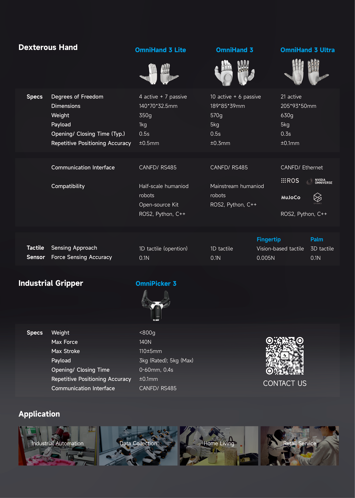
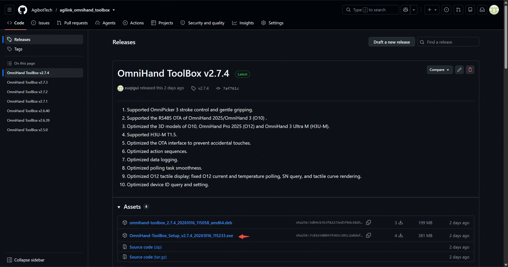
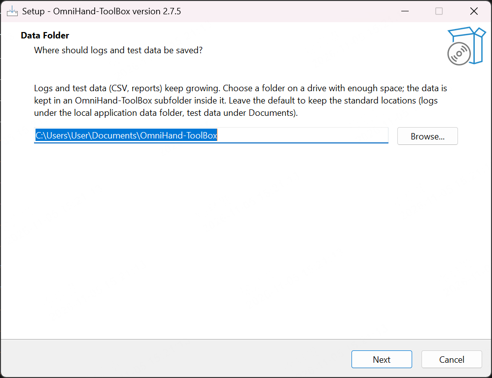
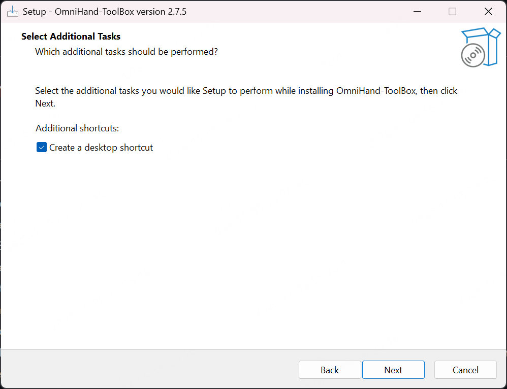
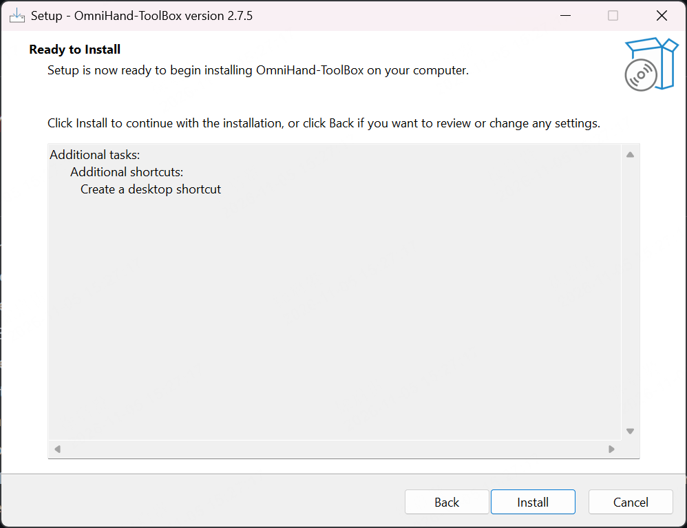
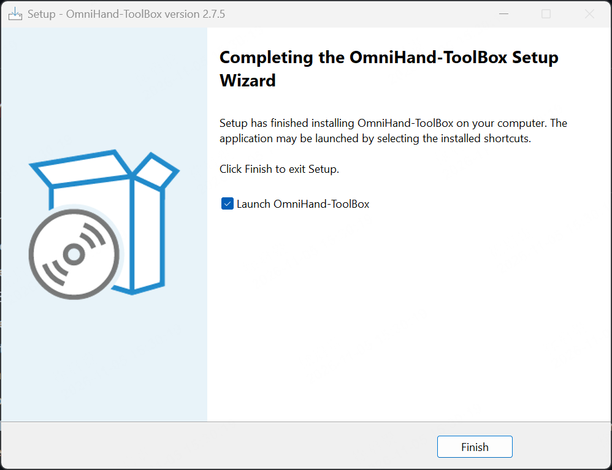
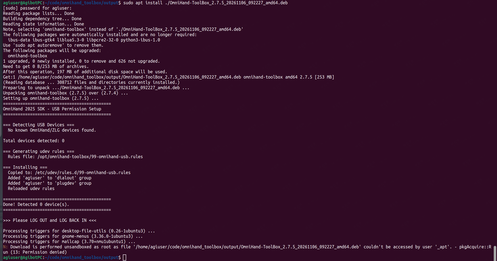

# AGILINK OmniHand-ToolBox

[中文说明](README_zh_cn.md)

## Overview



## Prerequisites

| Item | Requirement |
| --- | --- |
| Operating system | Windows 10 / 11 (64-bit); Ubuntu 22.04 LTS (64-bit) |
| CPU | Intel Core i5, 8th generation or later (dual-core, above 1.5 GHz) |
| Memory | 8 GB or more |
| Display | OpenGL 3.3 or later; integrated graphics are sufficient. A resolution of 1920×1080 or higher is recommended. The main interface uses a multi-column layout; higher resolutions allow more columns to be expanded at once. |
| Communication hardware | Single-/dual-channel USB-to-CAN FD adapter (ZLG / HCAN), with no separate driver installation required. SocketCAN on Ubuntu requires the corresponding CAN FD driver. Some products also support RS485 or USB. |
| Software dependencies | The installer includes the Qt runtime and SDK; no separate Qt installation is required. |

## Download and Installation

[Download](https://github.com/AgibotTech/agilink_omnihand_toolbox/releases)

### **Windows x64**

Download and run the `.exe` installer. If prompted to install Microsoft runtime components, allow the installation.



Click `Next` to use the default installation directory, or click `Browse` to choose another directory.



Click `Next` to keep the default option to create a desktop shortcut, or clear the checkbox if you do not want one.



Click `Install` to install with the selected settings, or click `Back` to change them.



When installation is complete, click `Finish`. The option to launch OmniHand-ToolBox is selected by default.



### **Ubuntu 22.04+ x64**

```shell
sudo apt install OmniHand-ToolBox*.deb
```



## User Guides

[OmniHand 2025 & OmniHand 3 Guides](omnihand_2025_guides.md)

[OmniHand 3 Lite S/M Guides](omnihand_3_lite_guide.md)

## License

Mulan PSL v2 - Copyright (c) 2025, Agibot Co., Ltd.
