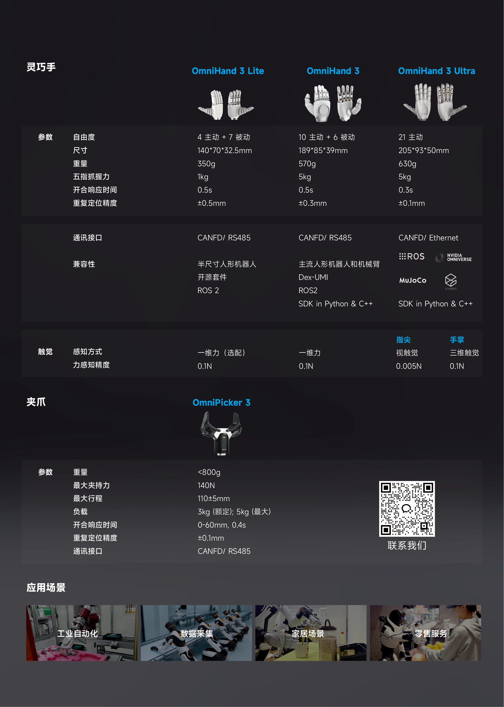
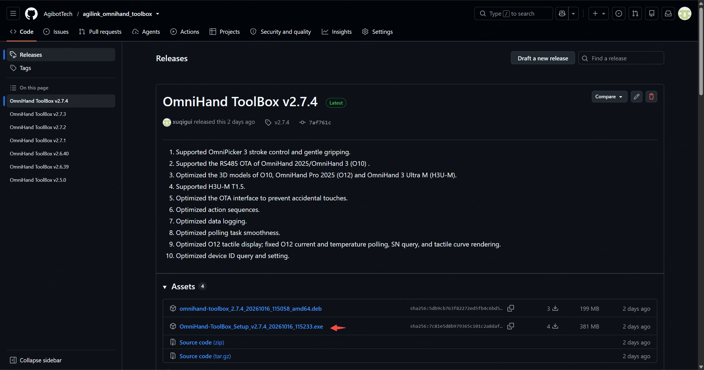
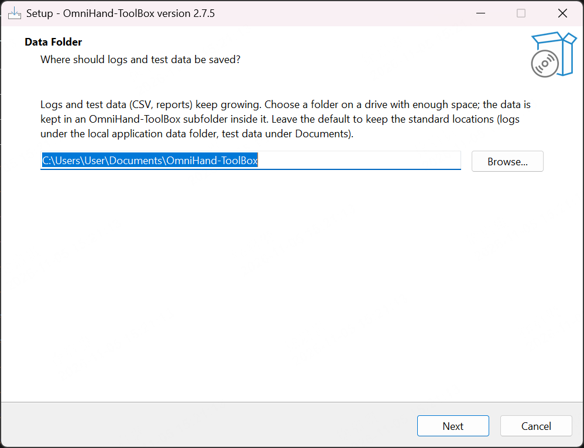
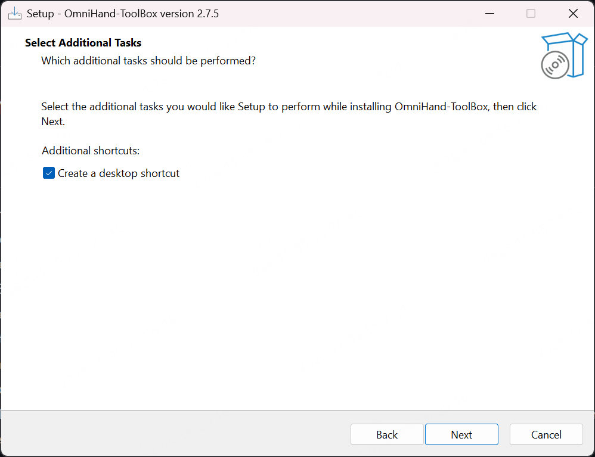
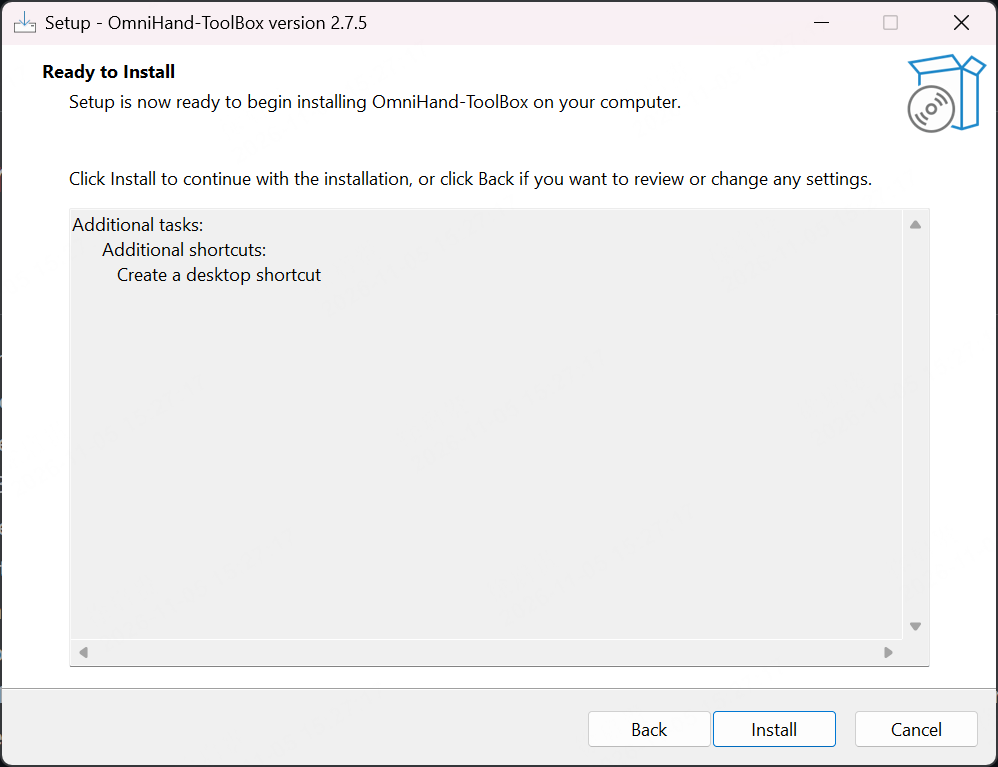
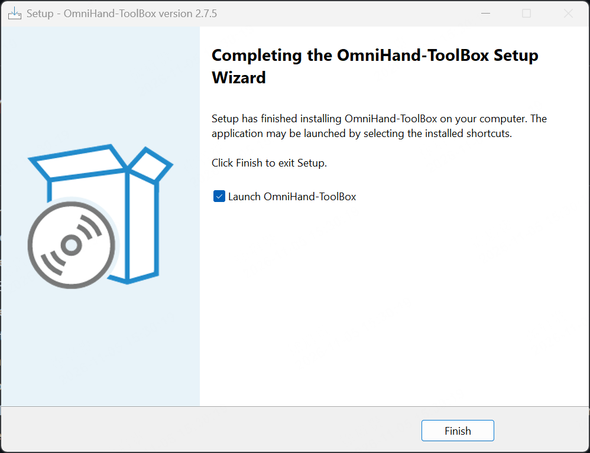

# AGILINK OmniHand-ToolBox

[English Guides](README.md)

## 产品概述



## 前置条件

| 类型 | 要求 |
| ------- | --------------- |
| 操&#8288;作&#8288;系&#8288;统 | Windows 10 / 11（64 位）；Ubuntu 22.04 LTS（64 位） |
| CPU | Intel 酷睿 i5 八代及以上（双核 1.5 GHz 以上） |
| 内存 | 8 GB 及以上 |
| 显示 | 支持 OpenGL 3.3 及以上（集成显卡即可），建议分辨率 1920×1080 及以上。主界面为多栏并列布局，分辨率越高可同时展开的分栏越多。 |
| 通&#8288;信&#8288;硬&#8288;件 | 单/双通道 USB 转 CANFD 盒（ZLG / HCAN）无需安装驱动；如在Ubuntu系统上使用SocketCan，需安装对应 CANFD 驱动。部分产品支持RS485或者USB。 |
| 软&#8288;件&#8288;依&#8288;赖 | 安装包已内置 Qt 运行库与 SDK，无需单独安装 Qt。 |

## 下载安装

[下载链接](https://github.com/AgibotTech/agilink_omnihand_toolbox/releases)

### **Windows x64**

下载后缀为exe的文件直接安装即可。中途如果遇到安装Mircosoft插件的请求，请无脑允许安装。



可以直接点击`Next`使用默认安装路径，也可以点击`Browse`选择指定安装路径。



可以直接点击`Next`默认勾选创建桌面快捷方式，也可以手动取消勾选。



确定使用默认配置则点击`install`直接安装，否则点击`Back`返回配置。



安装完成点击`Finish`，默认选择勾选启动OmniHand-ToolBox。




### **Ubuntu 22.04+ x64** 


```shell
sudo apt install OmniHand-ToolBox*.deb
```

## 使用说明

[OmniHand 2025 & OmniHand 3 Guides](omnihand_2025_guides_zh_cn.md)

[OmniHand 3 Lite S/M Guides](omnihand_3_lite_guide.md)


## 许可证

Mulan PSL v2 - Copyright (c) 2025, Agibot Co., Ltd.