# OmniHand 3 Lite S User Guide

[简体中文](omnihand_3_lite_guide_zh_cn.md)

## Login

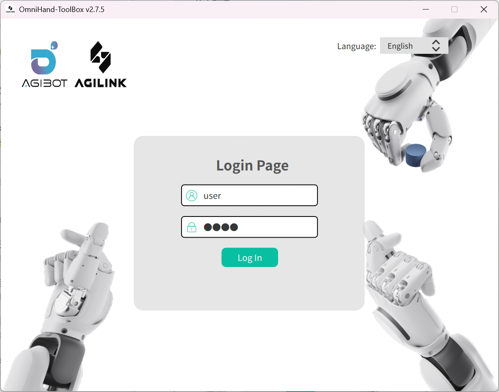

The window title shows the ToolBox version, for example, `OmniHand-ToolBox v2.7.5`.

Use the language selector in the upper-right corner to switch between **简体中文** and **English**.

Click **Login** to enter the User main interface. Both the default username and password are `user`; no changes are required.

## Main Interface

After login, the main interface opens:

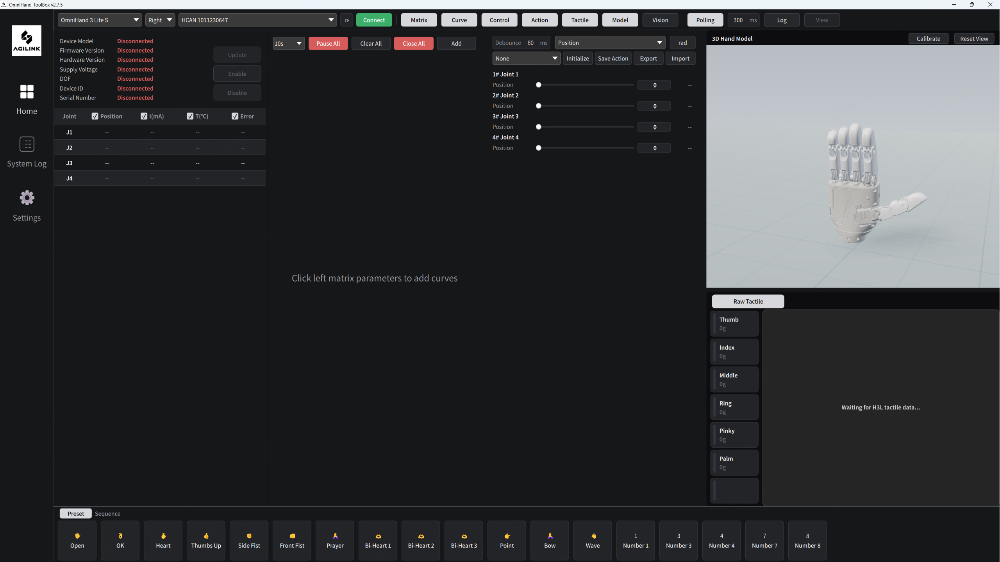

### Main Interface Layout

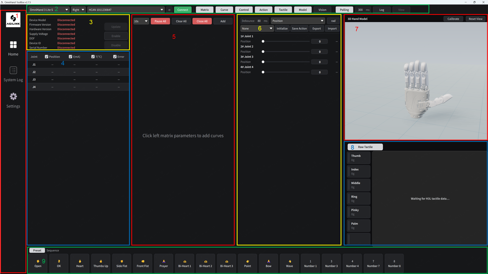

The main interface has nine primary areas and an optional vision tracking area:

1. **Navigation:** Main, [System Log](#system-log), and [Settings](#settings).
2. **Connection and layout:** [Quick Connection](#quick-connection-and-device-status), [Display Switches](#display-switches), and [Polling](#polling-and-joint-status-matrix).
3. **Device status:** device information, motor enable/disable controls (see [Quick Connection and Device Status](#quick-connection-and-device-status)), and [Firmware Update](#firmware-update).
4. **Joint status:** polling checkboxes and the status matrix (see [Polling and Joint Status Matrix](#polling-and-joint-status-matrix)).
5. **Curves:** live charts and chart controls (see [Real-Time Curves](#real-time-curves)).
6. **Control:** control modes, action library import/export, and joint parameter sliders (see [Joint Control](#joint-control)).
7. **Hand model:** a 3D preview that follows joint positions (see [3D Hand Model](#3d-hand-model)).
8. **Tactile distribution:** the Raw Pressure Data tab (see [Tactile Distribution](#tactile-distribution)).
9. **Action configuration:** Preset Actions and Action Sequence tabs (see [Action Configuration](#action-configuration)).
10. **Vision tracking:** an optional area that replaces the control column while visible.

### Display Switches

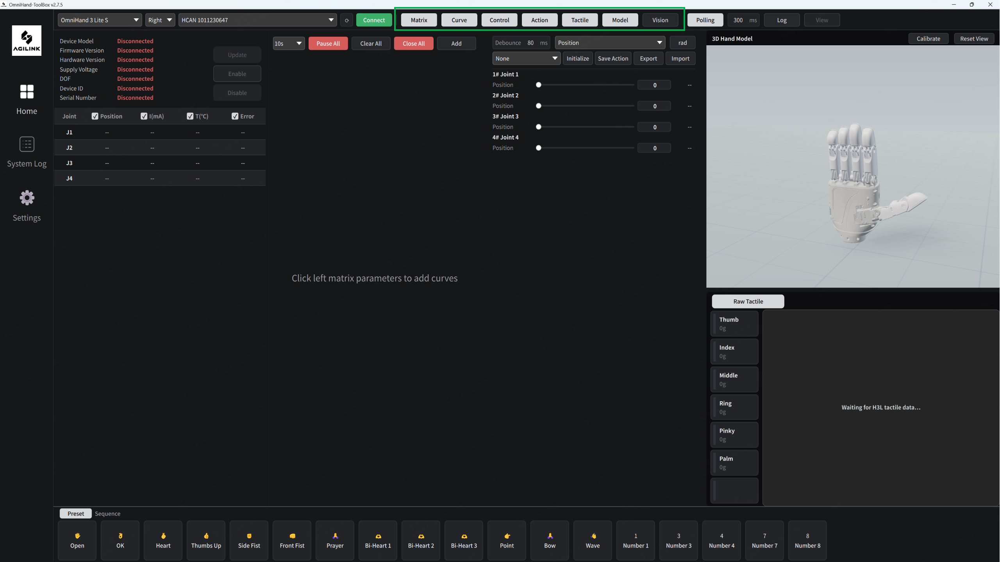

A highlighted switch means the corresponding area is visible; a dimmed switch means it is hidden.

- **Matrix:** expand or collapse the data rows in area ④. The position, current, temperature, and error polling checkboxes remain visible in the header.
- **Curve:** show or hide area ⑤, the curve column.
- **Control:** show or hide area ⑥, the control column.
- **Actions:** show or hide area ⑨, action configuration.
- **Tactile:** show or hide area ⑧, tactile distribution. This switch also controls tactile acquisition.
- **Model:** show or hide area ⑦, the hand model.
- **Vision:** show or hide area ⑩, [Vision Tracking](#vision-tracking). While visible, it replaces the [control column](#joint-control).

### Quick Connection and Device Status

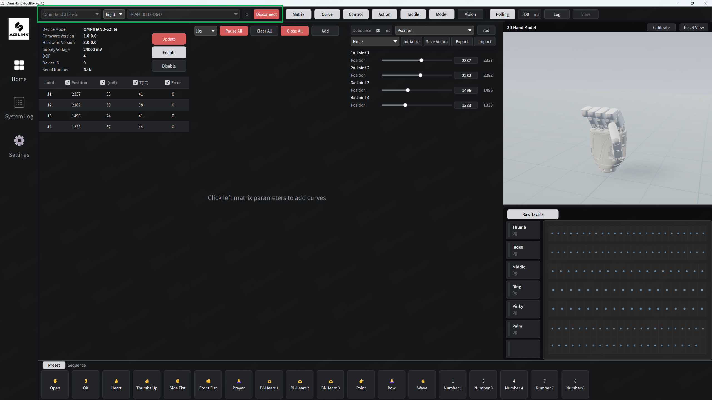

1. Connect the hand to the computer through a ZLG CAN or HCAN adapter, then power on the OmniHand. The recommended supply voltage is **24 V**.
2. Select a detected CAN FD adapter from the device dropdown. If it shows **No device found**, click **⟳** on the right to refresh the list.
3. Select the product and the left/right hand. This product appears as **OmniHand 3 Lite S** in the product dropdown.
4. Click **Connect**. After a successful handshake, the device information area displays the actual device details, and the green **Connect** button becomes a red **Disconnect** button.

For RS485 or detailed connection settings, such as CAN adapter index, channel, serial port, and baud rate, open [Settings](#settings) from the navigation bar.

If the device dropdown still shows **No device found** after refreshing, check the CAN adapter or USB-to-RS485 adapter and its connection to the computer. ZLG CAN and HCAN are supported. SocketCAN is also supported on Ubuntu when the adapter's official SocketCAN driver is installed and the interface is configured for **1 Mbit/s arbitration at an 80% sample point and 5 Mbit/s data at a 75% sample point** (`1M@80% + 5M@75%`).

The following screenshot shows a successful connection:

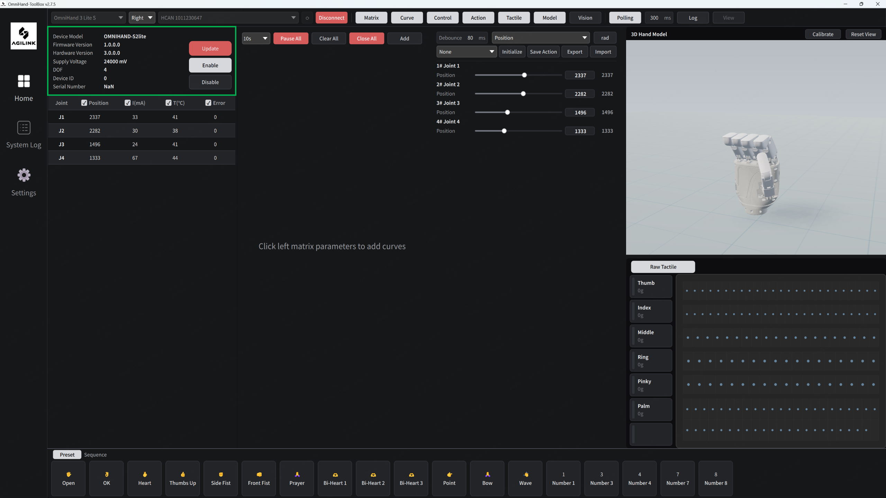

- **Update:** open the [Firmware Update](#firmware-update) page.
- **Enable / Disable:** control whether the hand's motors respond to control commands. Disabled joints do not execute position commands.
- **Device information:** seven items are shown: model, firmware version, hardware version, supply voltage, degrees of freedom, device ID, and serial number.

When disconnected, the device information fields show **Disconnected** in red:

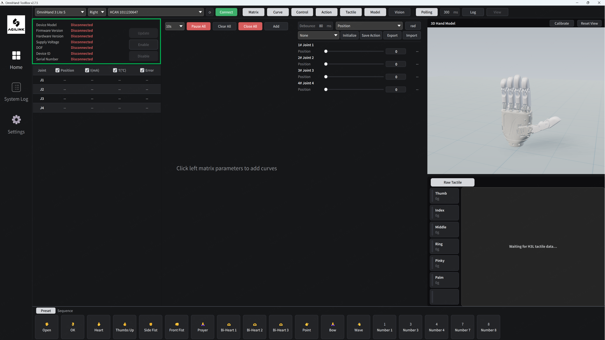

If the CAN adapter is connected but communication with the hand fails, the fields show **Unavailable** in yellow. Check the hand's power supply, wiring, connectors, and pin assignments:

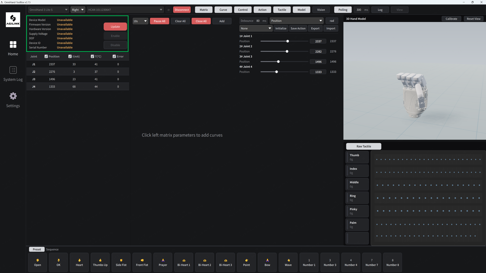

An abnormal CAN adapter connection may indicate that the adapter was unplugged or has a loose connection:

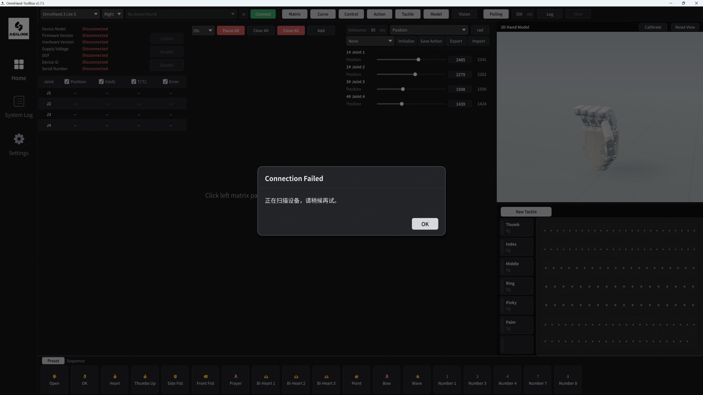

### Polling and Joint Status Matrix

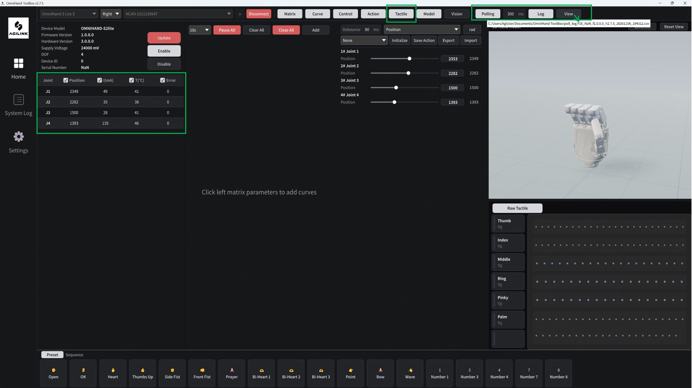

**Polling:** enable periodic queries to the hand at the configured interval. Disabling it stops periodic queries, and the matrix retains the last values received.

**Interval (ms):** the polling interval, **300 ms** by default. Press **Enter** to apply a change. Shorter intervals increase bus load; the default is generally sufficient.

**Record:** continuously write polled data to a CSV file while enabled.

**View:** hover over this button to see the recording's full CSV path; click it to open the containing folder.

**Joint status matrix:** each row shows a joint's position, current (mA), temperature (℃), and error code. Fields show `--` when disconnected.

The position, current, temperature, and error checkboxes in the matrix header independently select which parameters are polled. The top **Tactile** switch controls both tactile visibility and whether tactile data is queried.

Click a parameter cell in the matrix to add a live chart for that joint and parameter (see [Real-Time Curves](#real-time-curves)).

### Real-Time Curves

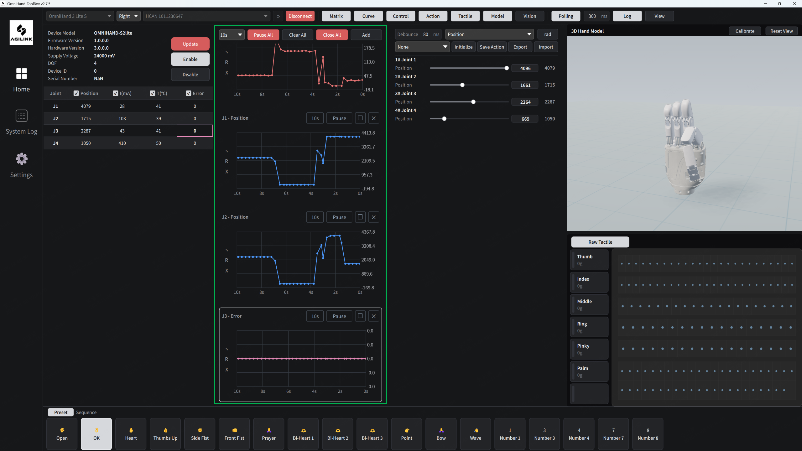

The toolbar at the top of the curve column provides these controls:

- **Time window:** choose the duration shown on the X axis, with options from 1 second to 5 minutes.
- **Pause All / Resume All:** pause or resume updates to all chart views.
- **Clear All:** clear the data in all charts.
- **Close All:** close all chart cards.
- **Add:** open the chart selection dialog, choose a joint and parameter, and add a chart. Available parameters include position, current, temperature, velocity, torque, and error. For tactile parameters, select a finger or palm region instead of a joint.

If polling is disabled or a parameter's checkbox is cleared, that polled data stops updating and its polling chart freezes.

When no charts are open, a prompt asks you to click a parameter in the matrix. Clicking a matrix cell also adds its chart.

Each chart card provides the following controls:

- **Drag:** the first of the three small controls on the left. It appears only in card mode; drag it to reorder chart cards.
- **Reset (R):** the second control on the left. Reset X/Y zoom and the view to their defaults. Shortcut: **Ctrl + R**.
- **Clear (X):** the third control on the left. Clear the chart's existing data and start plotting again.
- **Time window:** at the upper right of the card. It works like the column's time-window dropdown but affects only this chart. Its tooltip lists zoom and pan shortcuts.
- **Pause / Resume:** pause or resume updates to this chart view.
- **Maximize / Restore:** expand the chart to fill the window or return it to card mode.

Move the pointer over the target chart before using these shortcuts:

| Shortcut | Function |
| --- | --- |
| Ctrl + ↑ / ↓ | Zoom the Y axis in / out |
| Ctrl + → / ← | Zoom the X axis in / out |
| Ctrl + Shift + ↑ / ↓ | Pan vertically |
| Ctrl + Shift + ← / → | Pan horizontally while paused |
| Ctrl + R | Reset the view |

### Joint Control

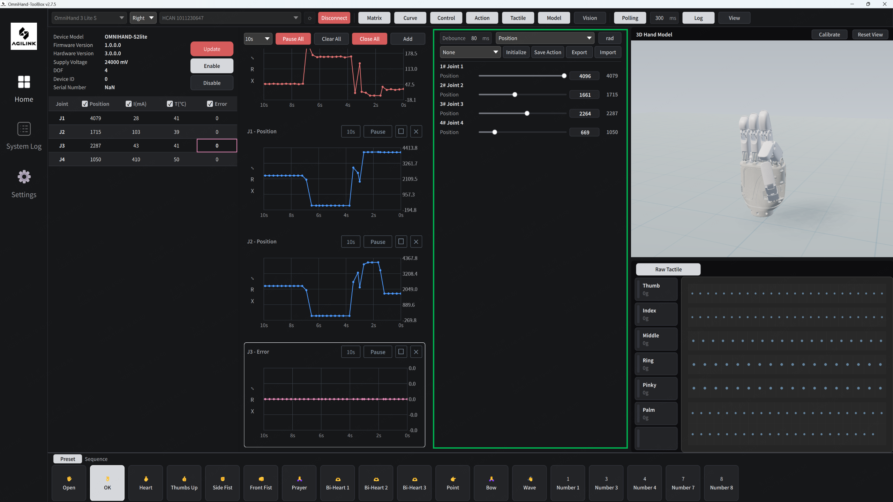

**Debounce:** set the interval in milliseconds at which slider changes are sent, reducing the CAN FD bus load caused by continuous input.

**Control mode:** this product supports position, position＋torque, and position＋velocity＋torque control.

| Mode | Command Parameters | Description |
| --- | --- | --- |
| Position | Motor encoder position, 0–4096 | Default mode; set the target joint position only |
| Position＋Torque | Position and torque current, 0–1000 mA | Limit joint torque current while controlling position; default current: 300 mA |
| Position＋Velocity＋Torque | Position, velocity (rpm), and torque current (mA) | Also specify motor speed; default speed: 8000 rpm |

**rad:** off and dimmed by default, meaning sliders and inputs use motor encoder values from 0 to 4096. When enabled and highlighted, they use joint angles in radians. Actions saved in this mode store radian angles.

**Action dropdown:** lists the custom actions available for the selected left/right hand. Selecting an action updates the sliders to its saved positions and immediately sends the action to the hand. The first entry, **None**, means no action is selected. To delete an action, right-click its row or click the **✕** shown on hover.

**Initialize:** return all joints to the initial positions captured when the device connected.

**Save Action:** save the current slider positions as a custom action; enter a name when prompted. Regardless of which hand is connected, saving keeps mirrored left/right versions of the action. The saved action then appears in the **Action dropdown** list. To export it to a file, use **Export Action Library**.

**Export:** export all custom actions in the library to a `.json` file (see [Action Files](#action-files)).

**Import:** read actions from a `.json` file and add them to the library. If names conflict, a confirmation dialog lists the actions that will be overwritten.

**Joint sliders:** each joint has a number and name, followed by parameter sliders, target-value inputs, and current feedback values. Drag a slider to control the joint, or type a target value and press **Enter** to send it.

### 3D Hand Model

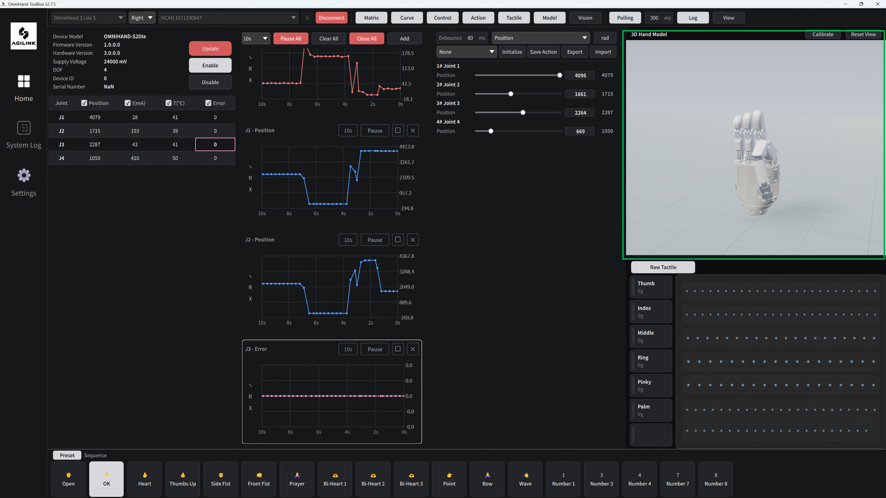

After connection, the model follows the joints' current positions. Use the mouse to rotate, zoom, or pan the view. Turn off **Model** in the top toolbar when it is not needed to free space for the curve and tactile areas.

**Calibration:** restore the physical hand and the model to the default pose.

**Reset View:** restore the default camera view.

### Tactile Distribution

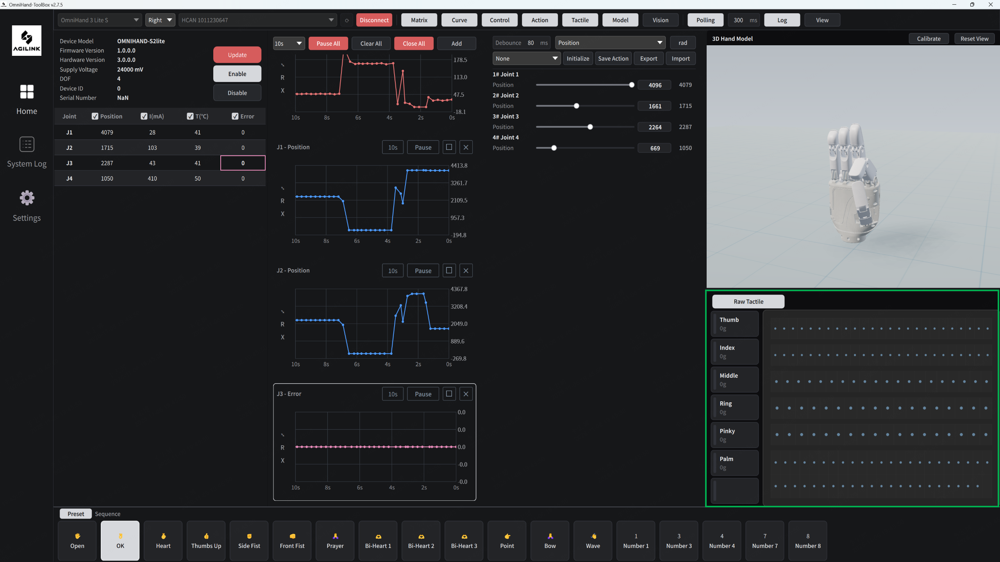

The top **Tactile** switch is enabled and highlighted by default. While enabled, the tactile area displays live data. Turn it off to hide the area.

There is one tab:

- **Raw Pressure Data:** display individual sensor measurement points.

The display is arranged as follows:

- **Regional readings on the left:** show the total force in g for each of six regions: Thumb, Index, Middle, Ring, Pinky, and Palm. The color bar beside each value changes from blue to red as force increases, making contact regions easy to identify.
- **Dot matrix on the right:** show the measurement points of each region as a dot matrix.

Raw pressure cells display **point indices**; hover over a cell to see its value in g.

### Action Configuration

The action configuration area has two tabs: **Preset** and **Sequence**.

**Preset**

These are the fixed gestures built into the SDK, 18 in total: Open, OK, Heart, Thumbs Up, Side Fist, Front Fist, Prayer, Bi-Heart 1, Bi-Heart 2, Bi-Heart 3, Point, Bow, Wave, Number 1, Number 3, Number 4, Number 7, and Number 8. Click a button to move the hand to the corresponding pose. Built-in gestures cannot be edited.

When switching between gestures, the hand first returns joints 3 and 4 to an intermediate pose, pauses briefly, and then moves to the target gesture. This is normal.


**Action**

Combine actions into a sequence for repeated execution:

- **＋:** add an action card. Click the card's name to open its editor, select an action from the dropdown, and enter the interval after that action in milliseconds.
- **Record:** when highlighted, record runtime data to CSV during sequence playback.
- **View:** hover to see the recording's full CSV path; click to open its folder.
- **Count:** enter a repeat count, or select **∞** for continuous playback. The completed repeat count is shown beside it.
- **Import:** load an action sequence from a JSON file (see [Action Files](#action-files)).
- **Export:** save the current action sequence to a local JSON file.
- **Clear:** remove all action cards from the current sequence, avoiding the need to delete a long imported sequence one step at a time.
- **Play / Stop:** execute the steps in order or stop playback. The current step is shown beside the controls.

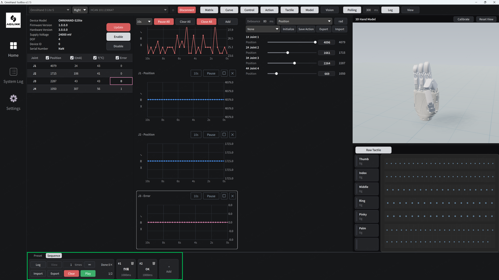

### Action Files

**Action library file (JSON):** imported/exported through the control column; defines individual actions. Action names in these examples are preserved as identifiers, including Chinese names.

```json
{ 
    "actions": [
        {
            "hand_type": "left",
            "name": "OK",
            "pos_axis_1": 0,
            "pos_axis_2": 0.830054,
            "pos_axis_3": 0.523019,
            "pos_axis_4": 1.314238,
            "position_type": "rad"
        },
        {
            "hand_type": "right",
            "name": "OK",
            "pos_axis_1": 0,
            "pos_axis_2": 0.830054,
            "pos_axis_3": 0.523019,
            "pos_axis_4": 1.314238,
            "position_type": "rad"
        },
        {
            "hand_type": "left",
            "name": "Heart",
            "pos_axis_1": 1.396263,
            "pos_axis_2": 1.02504,
            "pos_axis_3": 0.570125,
            "pos_axis_4": 0.888175,
            "position_type": "rad"
        },
        {
            "hand_type": "right",
            "name": "Heart",
            "pos_axis_1": 1.396263,
            "pos_axis_2": 1.02504,
            "pos_axis_3": 0.570125,
            "pos_axis_4": 0.888175,
            "position_type": "rad"
        }
    ],
    "format": "omnihand-actions",
    "product_type": "OMNIHAND_3_LITE",
    "product_variant": "H3L_S",
    "version": 3
}
```

**Action sequence file (JSON):** imported/exported through the Action Sequence tab. Steps can use preset gestures, individual actions from the action library, or actions loaded from a local file.

```json
{
    "format": "omnihand-sequence",
    "product_type": "OMNIHAND_3_LITE",
    "sequence_name": "默认序列",
    "steps": [
        {
            "delay_ms": 1000,
            "gesture_id": 1,
            "name": "OK",
            "source": "preset"
        },
        {
            "delay_ms": 1000,
            "gesture_id": 11,
            "name": "Bow",
            "source": "preset"
        }
    ],
    "version": 2
}

```

### Vision Tracking

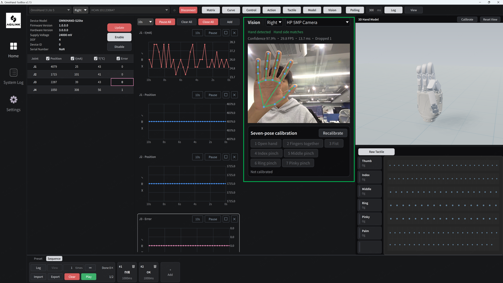

**Left / Right Hand:** choose which human hand to track.

**Camera dropdown:** select the camera to use.

**Recalibrate:** enter calibration mode. Match each pose demonstrated by the 3D model with the selected human hand, then click the highlighted step button to capture that pose and advance to the next step.

### Firmware Update

Click **Update** in the device information area:

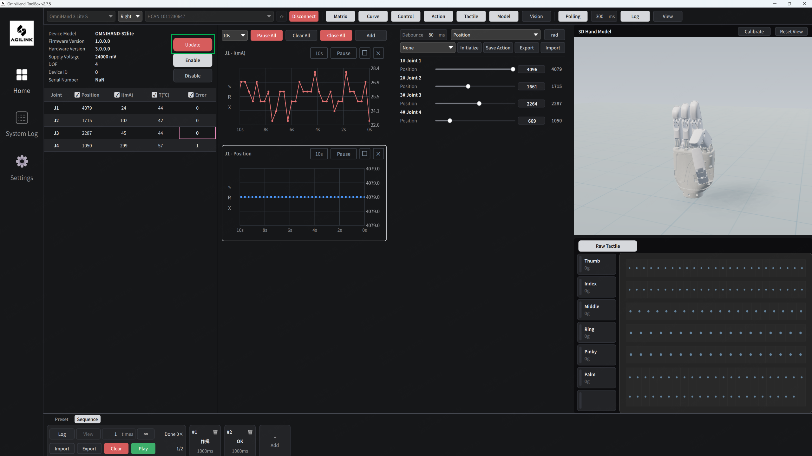

Click **Select**, choose the firmware file from a local folder, and start the update:

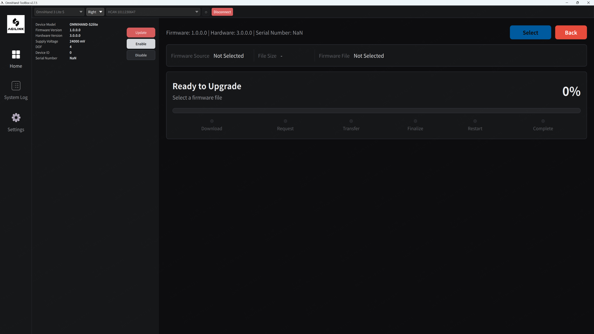

Wait for the update to complete and progress to reach **100%**, then click **Back** to return to the main interface:

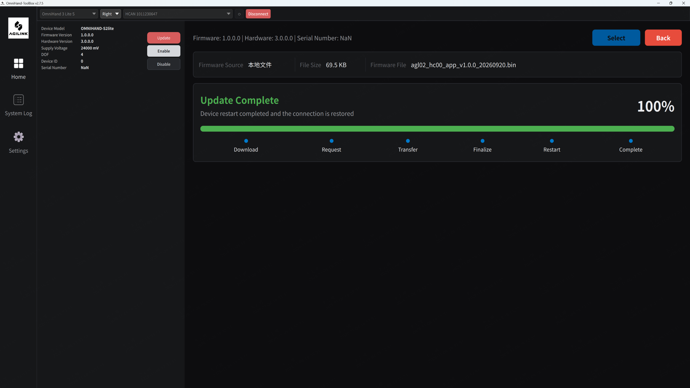

### Matrix and Curves

Click a numeric matrix cell to open its chart, or use **Add** in the curve column to select a joint and parameter. Available chart types include polled values, command/feedback comparisons, and tactile data. Each card can be paused, cleared, maximized, or closed; the toolbar applies pause, clear, and close to all charts.

Click a legend to show or hide its series, and hover over the plot to inspect values. Pausing a chart freezes its view while acquisition continues; turning off **Polling** stops periodic acquisition.

### System Log

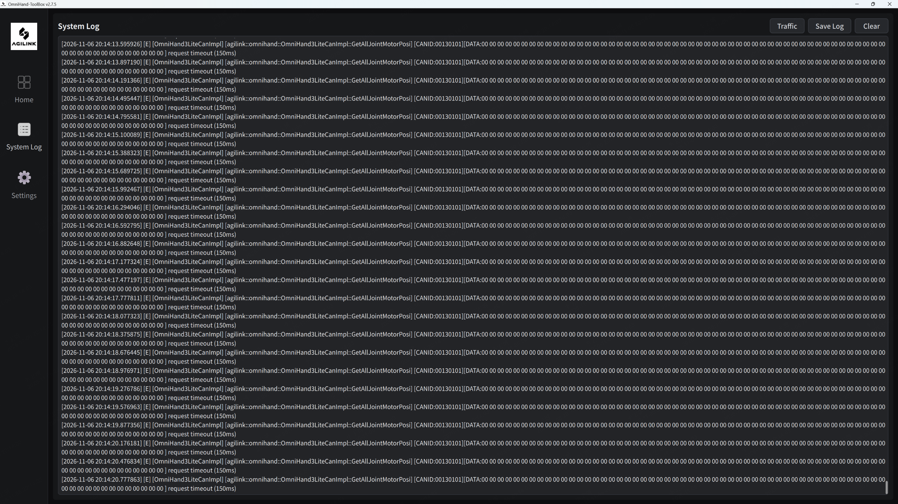

- **Traffic:** enable this switch to display transmitted and received messages.
- **Save Log:** export the log.
- **Clear:** clear the displayed log in the screen.

### Settings

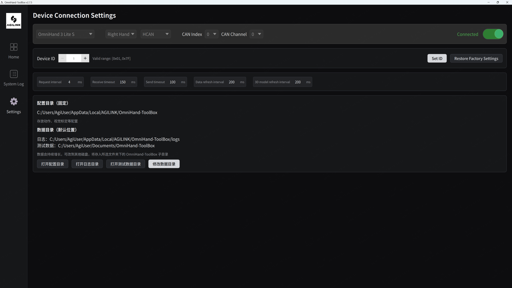

The settings page provides the full connection configuration:

- **Product:** select **OmniHand 3 Lite S**, the model name of this product in the software.
- **Hand:** select right or left.
- **Connection type:** ZLGCAN, HCAN (both CAN FD), or RS485. SocketCAN is also available on Linux. The parameter area changes with the selected connection type.
- **Connection parameters:** for CAN FD, set the adapter index and channel to match the USB-to-CAN FD adapter (defaults: `0 / 0`). For RS485, set the serial port and baud rate.
- **Connection switch:** connect or disconnect using the switch on the right. The adjacent status text indicates disconnected, connecting, connection failed, or connected.
- **CAN FD bus parameters:** the application applies the fixed values required by the communication protocol; no manual configuration is needed.

Once connected, the product, connection type, and connection parameters are disabled. Disconnect before changing them. The left/right hand selection remains available while connected.

You can also set the device ID to a value from **0x01 to 0x7F**, or restore the factory-default device ID.

Timing settings include:

- **Request interval:** the gap between successive requests.
- **Send timeout:** the maximum time the underlying send or write operation may wait.
- **Receive timeout:** the maximum wait for a reply frame; the operation returns as soon as the reply is received.
- **Data refresh period:** control how often the UI displays updated data.
- **Model refresh period:** control how often the 3D model is updated.

You can also open or change the data storage directory.
