# OmniHand 3 Ultra M User Guide

[简体中文](omnihand_3_ultra_m_guide_zh_cn.md)

This guide uses the OmniHand 3 Ultra M with 21 active joints as the example (the **DOF** field in the device information shows 21 after connecting).

## Login

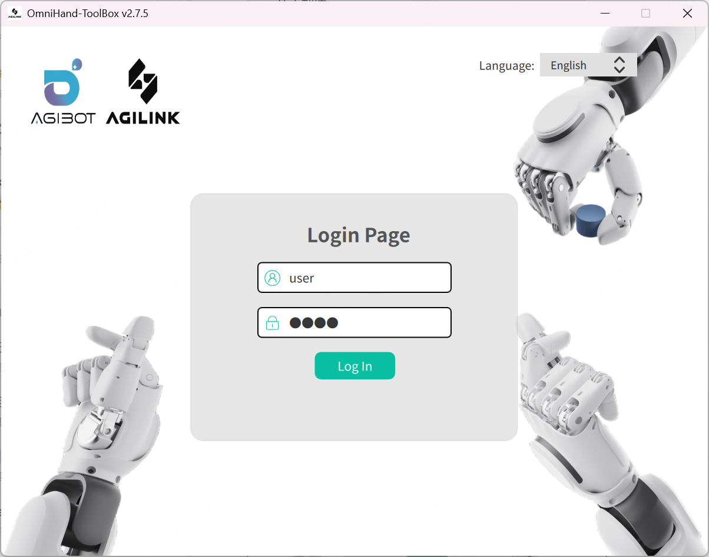

The window title shows the ToolBox version, for example, `OmniHand-ToolBox v2.7.6`.

Use the language selector in the upper-right corner to switch between **简体中文** and **English**.

Click **Login** to enter the User main interface. Both the default username and password are `user`; no changes are required.

## Main Interface

After login, the main interface opens:

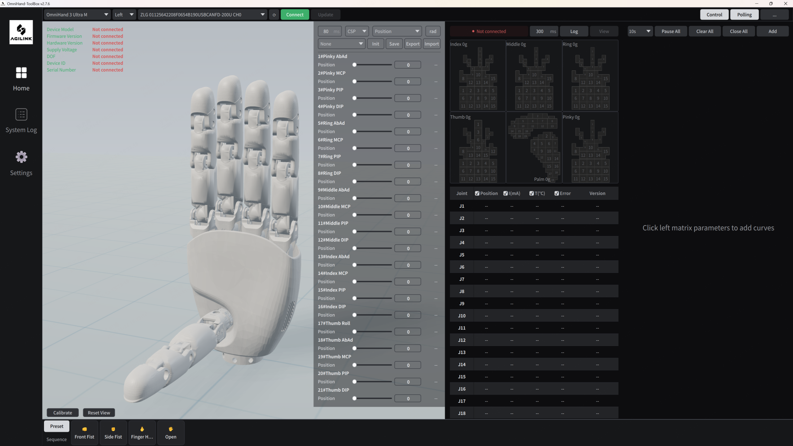

### Main Interface Layout

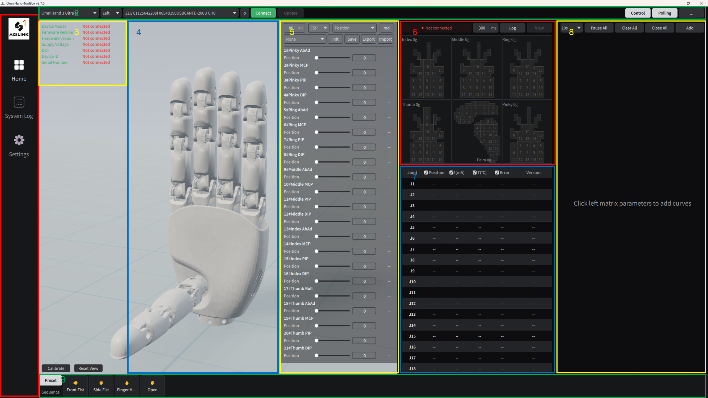

The main interface has nine areas:

1. **Navigation:** Home, [System Log](#system-log), and [Settings](#settings).
2. **Connection and layout:** product, hand, and device selection; **Connect / Disconnect**; **Update**, which becomes available after connecting (see [Quick Connection and Device Status](#quick-connection-and-device-status) and [Firmware Update](#firmware-update)); and the display switches at the upper right (see [Display Switches](#display-switches)).
3. **Device status:** device information (see [Quick Connection and Device Status](#quick-connection-and-device-status)).
4. **Hand model:** a 3D preview that follows joint positions, with **Calibrate** and **Reset View** at the lower left (see [3D Hand Model](#3d-hand-model)).
5. **Control:** control mode, control type, action library import/export, and the position sliders of the 21 joints (see [Joint Control](#joint-control)).
6. **Tactile distribution:** live tactile data for six regions: Index, Middle, Ring, Thumb, Palm, and Pinky; the polling status, interval, and **Log** controls are at the top (see [Tactile Distribution](#tactile-distribution) and [Polling and Joint Status Matrix](#polling-and-joint-status-matrix)).
7. **Joint status:** polling checkboxes and the status matrix (see [Polling and Joint Status Matrix](#polling-and-joint-status-matrix)).
8. **Curves:** live charts and chart controls (see [Real-Time Curves](#real-time-curves)).
9. **Action configuration:** Preset and Sequence tabs (see [Action Configuration](#action-configuration)).

### Display Switches

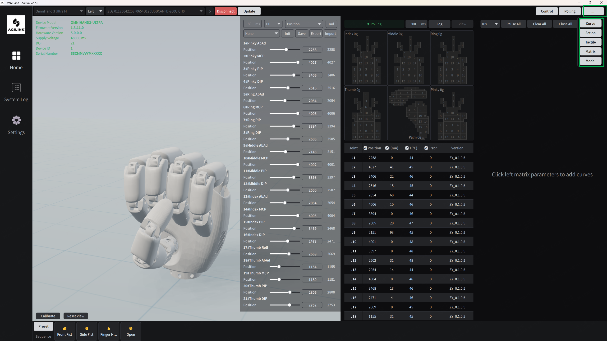

The **Control** and **Polling** buttons and the **...** menu are at the upper right. A highlighted switch means the corresponding area is visible; a dimmed switch means it is hidden.

- **Control:** show or hide area ⑤, the control column.
- **Polling:** turn polling on or off (see [Polling and Joint Status Matrix](#polling-and-joint-status-matrix)).

The **...** menu contains:

- **Curve:** show or hide area ⑧, the curve column.
- **Action:** show or hide area ⑨, action configuration.
- **Tactile:** show or hide area ⑥, tactile distribution. This switch also controls tactile acquisition.
- **Matrix:** expand or collapse the data rows in area ⑦. The position, current, temperature, and error polling checkboxes remain visible in the header.
- **Model:** show or hide area ④, the hand model.

### Quick Connection and Device Status

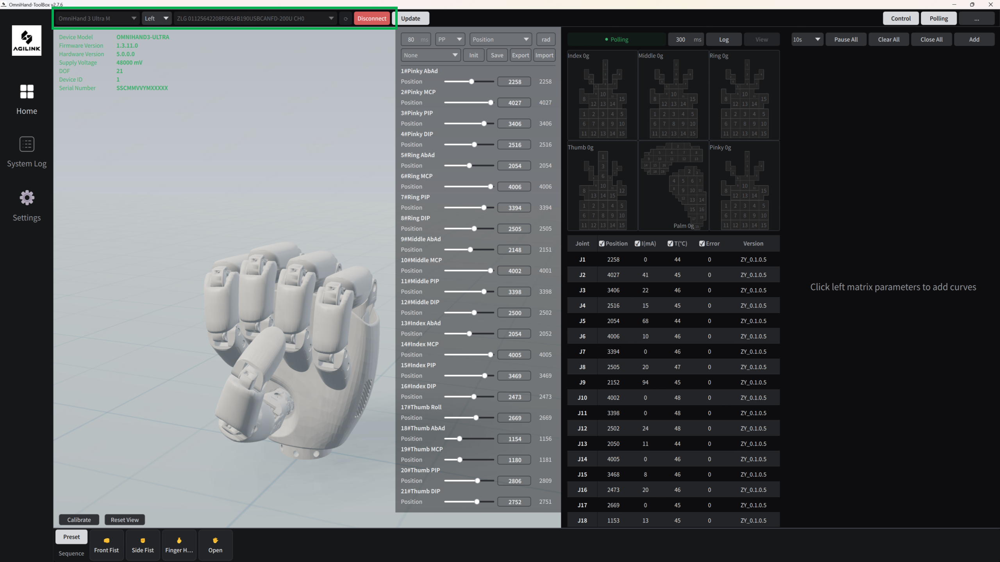

1. Connect the hand to the computer through a ZLG CAN or HCAN adapter, then power on the OmniHand. The recommended supply voltage is **48 V**.
2. Select a detected CAN FD adapter from the device dropdown, for example `ZLG ...USBCANFD-200U CH0`. If it shows **No device found**, click **⟳** on the right to refresh the list.
3. Select the product and the left/right hand. This product appears as **OmniHand 3 Ultra M** in the product dropdown.
4. Click **Connect**. After a successful handshake, the device information area displays the actual device details, and the green **Connect** button becomes a red **Disconnect** button. The **Update** button also becomes available.

For detailed connection settings, such as CAN adapter index and channel, open [Settings](#settings) from the navigation bar.

If the device dropdown still shows **No device found** after refreshing, check the CAN adapter and its connection to the computer. ZLG CAN and HCAN are supported. SocketCAN is also supported on Ubuntu when the adapter's official SocketCAN driver is installed and the interface is configured for **1 Mbit/s arbitration at an 80% sample point and 5 Mbit/s data at a 75% sample point** (`1M@80% + 5M@75%`).

The following screenshot shows a successful connection:

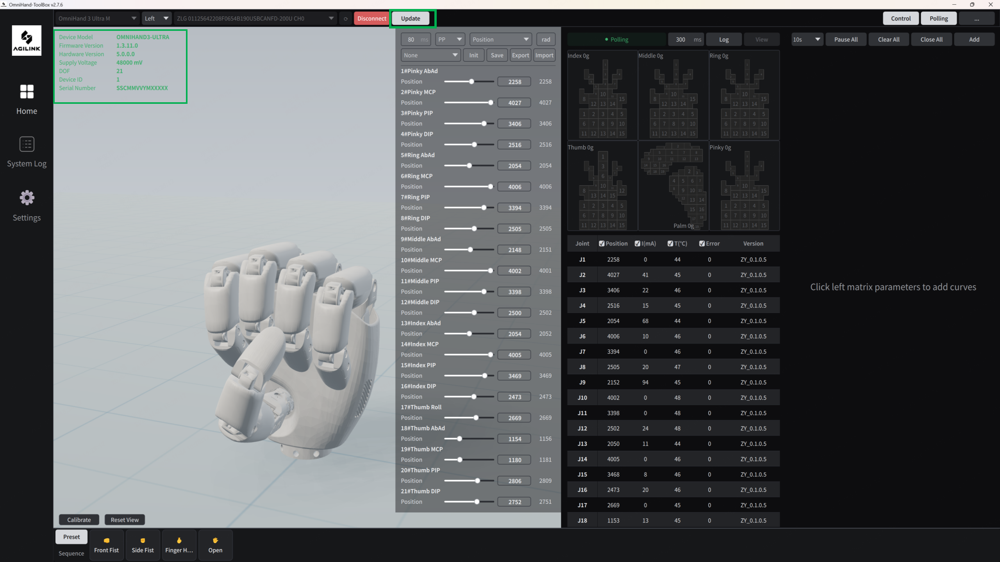

- **Update:** in the top connection bar; opens the [Firmware Update](#firmware-update) page.
- **Device information:** seven items are shown: model, firmware version, hardware version, supply voltage, degrees of freedom, device ID, and serial number.

When disconnected, the device information fields show **Not connected** in red:

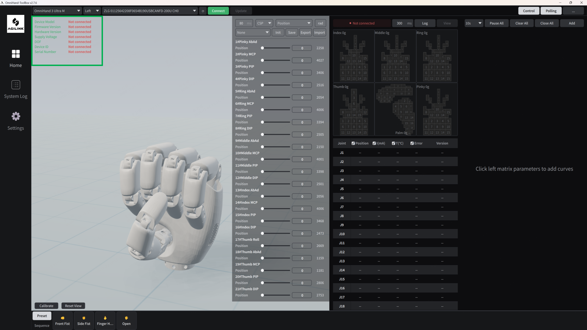

If the CAN adapter is connected but communication with the hand fails, the fields show **Unavailable** in yellow. Check the hand's power supply, wiring, connectors, and pin assignments:

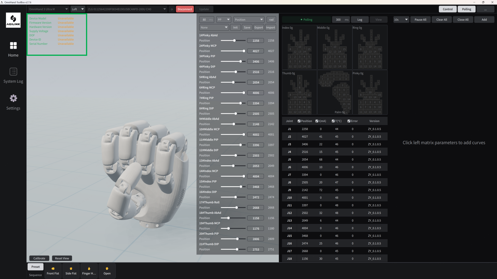

An abnormal CAN adapter connection may indicate that the adapter was unplugged or has a loose connection:

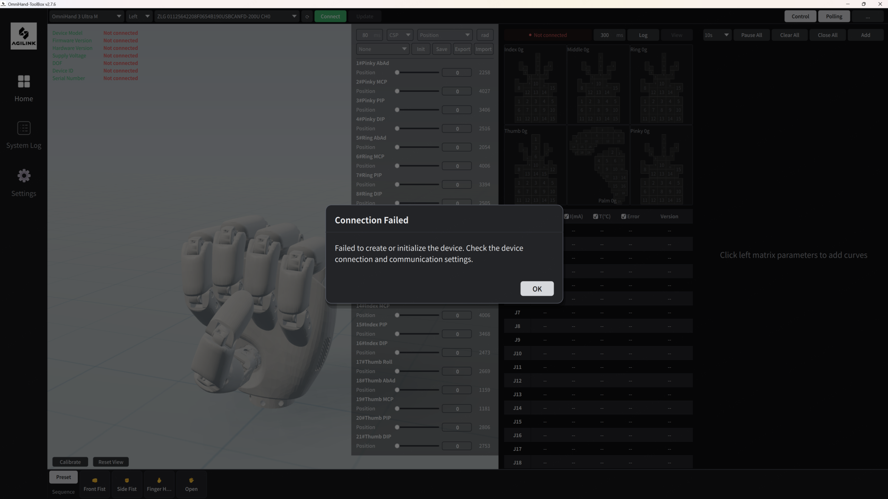

### Polling and Joint Status Matrix

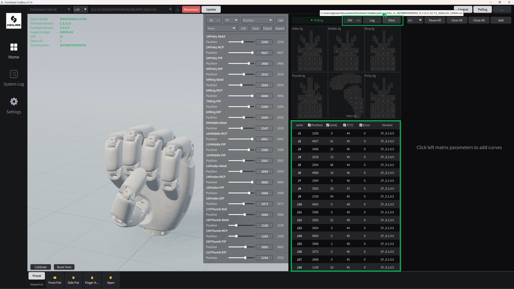

**Polling:** enable periodic queries to the hand at the configured interval. Disabling it stops periodic queries, and the matrix retains the last values received.

**Interval (ms):** the polling interval, **300 ms** by default. Press **Enter** to apply a change. Shorter intervals increase bus load; the default is generally sufficient.

**Log:** continuously write polled data to a CSV file while enabled.

**View:** hover over this button to see the recording's full CSV path; click it to open the containing folder.

**Joint status matrix:** each row shows a joint's position, current (mA), temperature (℃), error code, and version, for all 21 joints. Fields show `--` when disconnected. **Version** is the version number of that joint (for example, `ZY_0.1.0.5`).

The position, current, temperature, and error checkboxes in the matrix header independently select which parameters are polled. The **Tactile** switch in the **...** menu controls both tactile visibility and whether tactile data is queried.

Click a parameter cell in the matrix to add a live chart for that joint and parameter (see [Real-Time Curves](#real-time-curves)).

### Real-Time Curves

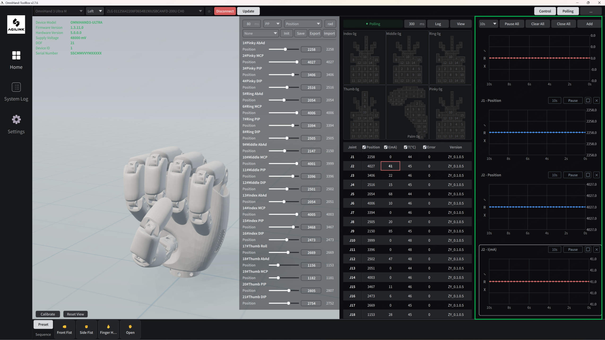

The toolbar at the top of the curve column provides these controls:

- **Time window:** choose the duration shown on the X axis, with options from 1 second to 5 minutes.
- **Pause All / Resume All:** pause or resume updates to all chart views.
- **Clear All:** clear the data in all charts.
- **Close All:** close all chart cards.
- **Add:** open the chart selection dialog, choose a joint and parameter, and add a chart. Available parameters are Position, Position (Cmd-Fb), Torque (mA) (Cmd-Fb), Speed (rpm) (Cmd-Fb), I (mA), T (°C), Error, and Motor Diagnostics. For Tactile (g), select a finger or palm region instead of a joint.

If polling is disabled or a parameter's checkbox is cleared, that polled data stops updating and its polling chart freezes.

When no charts are open, a prompt asks you to click a parameter in the matrix. Clicking a matrix cell also adds its chart.

Each chart card provides the following controls:

- **Drag:** the first of the three small controls on the left. It appears only in card mode; drag it to reorder chart cards.
- **Reset (R):** the second control on the left. Reset X/Y zoom and the view to their defaults. Shortcut: **Ctrl + R**.
- **Clear (X):** the third control on the left. Clear the chart's existing data and start plotting again.
- **Time window:** at the upper right of the card. It works like the column's time-window dropdown but affects only this chart. Its tooltip lists zoom and pan shortcuts.
- **Pause / Resume:** pause or resume updates to this chart view.
- **Maximize / Restore:** expand the chart to fill the window or return it to card mode.

Move the pointer over the target chart before using these shortcuts:

| Shortcut | Function |
| --- | --- |
| Ctrl + ↑ / ↓ | Zoom the Y axis in / out |
| Ctrl + → / ← | Zoom the X axis in / out |
| Ctrl + Shift + ↑ / ↓ | Pan vertically |
| Ctrl + Shift + ← / → | Pan horizontally while paused |
| Ctrl + R | Reset the view |

Click a legend to show or hide its series, and hover over the plot to inspect values. Pausing a chart freezes its view while acquisition continues; only turning off **Polling** stops periodic acquisition.

### Joint Control

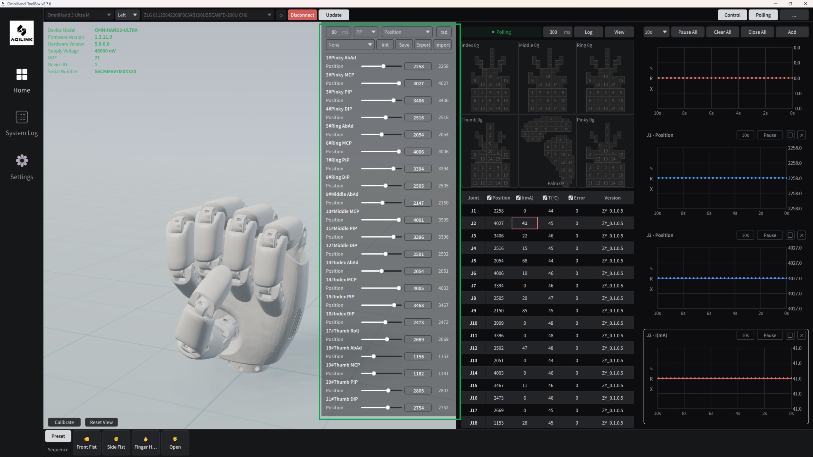

**Debounce:** set the interval at which slider changes are sent (default 80 ms), reducing the CAN FD bus load caused by continuous input.

**Control mode:** this product supports two position control modes, **CSP** and **PP**. After connecting, the control column reads and shows the hand's current mode.

| Mode | Description |
| --- | --- |
| CSP | Cyclic Synchronous Position: the application sends target positions continuously at a fixed period; suited to continuous following, such as dragging sliders |
| PP | Profile Position: after a target position is sent, the hand plans the motion and moves to the target by itself |

**Control type:** the dropdown to the right of the control mode, **Position** by default, with **Position + Torque** as the other option:

| Type | Command Parameters | Description |
| --- | --- | --- |
| Position | Motor encoder position | Default type; set the target joint position only |
| Position＋Torque | Position and torque current (mA) | Limit the joint torque current while controlling position; each joint gets an extra **Torque(mA)** slider; torque range: 0–2000 mA, default: 1900 mA |

**rad:** off and dimmed by default, meaning sliders and inputs use motor encoder values. When enabled and highlighted, they use joint angles in radians. Actions saved in this mode store radian angles.

**Action dropdown:** lists the custom actions available for the selected left/right hand. Selecting an action updates the sliders to its saved positions and immediately sends the action to the hand. The first entry, **None**, means no action is selected. To delete an action, right-click its row or click the **✕** shown on hover.

**Init:** return all joints to the initial positions captured when the device connected.

**Save:** save the current slider positions as a custom action; enter a name when prompted. Regardless of which hand is connected, saving keeps mirrored left/right versions of the action. The saved action then appears in the **Action dropdown** list. To export it to a file, use **Export**.

**Export:** export all custom actions in the library to a `.json` file (see [Action Files](#action-files)).

**Import:** read actions from a `.json` file and add them to the library. If names conflict, a confirmation dialog lists the actions that will be overwritten.

**Joint sliders:** each joint has a number and name, followed by a position slider, a target-value input, and the current feedback value. Drag a slider to control the joint, or type a target value and press **Enter** to send it. The 21 joints are arranged finger by finger (**AbAd** is the side swing; **MCP**, **PIP**, and **DIP** are the bending joints at the base, middle, and tip of the finger; **Thumb Roll** is the thumb's rotation):

| No. | Joint | No. | Joint | No. | Joint |
| --- | --- | --- | --- | --- | --- |
| 1 | Pinky AbAd | 8 | Ring DIP | 15 | Index PIP |
| 2 | Pinky MCP | 9 | Middle AbAd | 16 | Index DIP |
| 3 | Pinky PIP | 10 | Middle MCP | 17 | Thumb Roll |
| 4 | Pinky DIP | 11 | Middle PIP | 18 | Thumb AbAd |
| 5 | Ring AbAd | 12 | Middle DIP | 19 | Thumb MCP |
| 6 | Ring MCP | 13 | Index AbAd | 20 | Thumb PIP |
| 7 | Ring PIP | 14 | Index MCP | 21 | Thumb DIP |

### 3D Hand Model

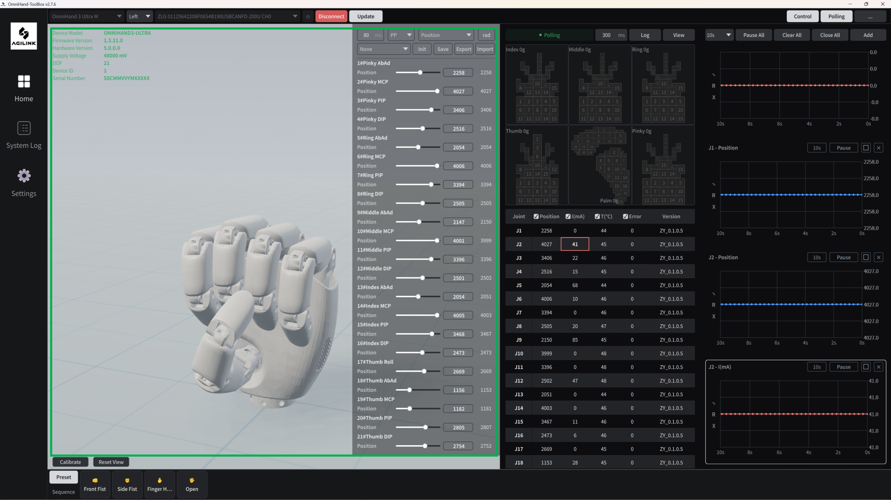

After connection, the model follows the joints' current positions. Use the mouse to rotate, zoom, or pan the view. Turn off **Model** in the **...** menu when it is not needed to free space for the curve and tactile areas.

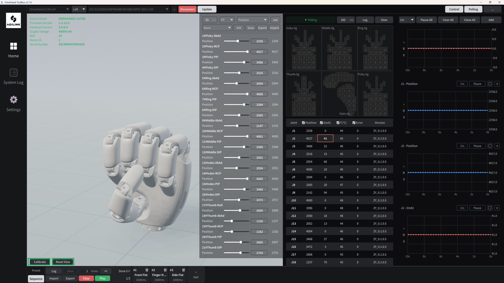

**Calibrate:** restore the physical hand and the model to the default pose.

**Reset View:** restore the default camera view.

### Tactile Distribution

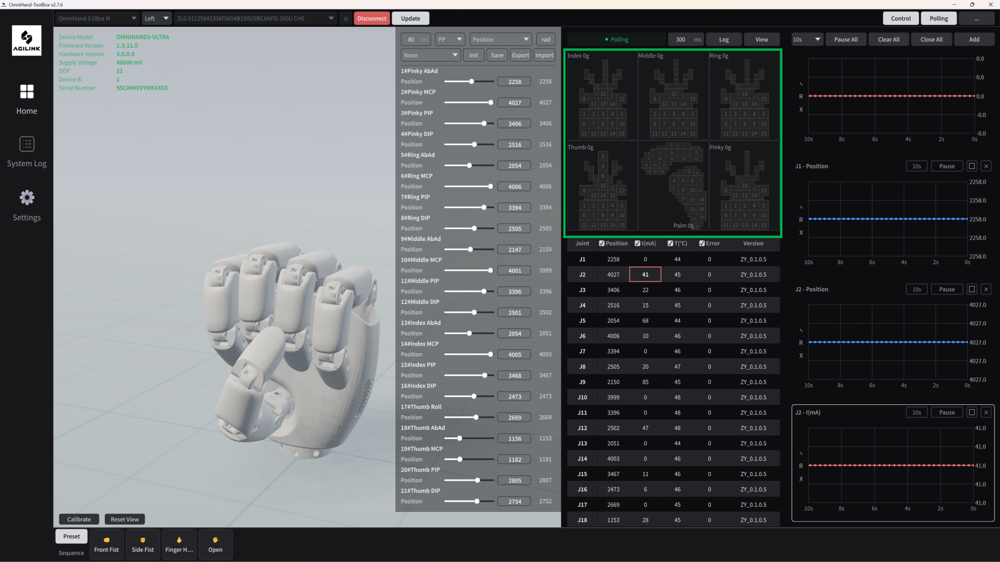

The **Tactile** switch in the **...** menu is enabled and highlighted by default. While enabled, the tactile area displays live data. Turn it off to hide the area.

The display is arranged as follows:

- **Region layout:** six regions: Index, Middle, Ring, Thumb, Palm, and Pinky. The title of each region shows its name and the total force on it in g, for example `Index 0g`.
- **Measurement points:** each region arranges its points in the shape of the actual sensor, and the numbers are the point indices. Each finger has 30 points and the palm has 38 points.

Whether tactile data is refreshed depends on whether the **Tactile** switch is on (see [Polling and Joint Status Matrix](#polling-and-joint-status-matrix)).

### Action Configuration

The action configuration area has two tabs: **Preset** and **Sequence**.

**Preset**

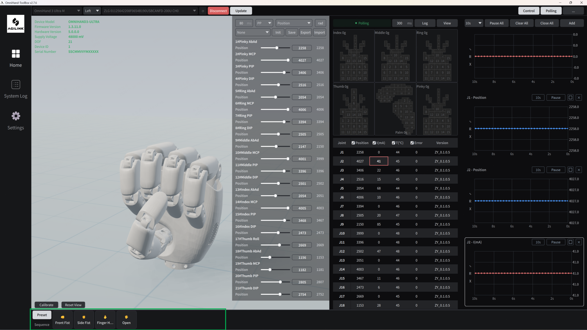

These are the fixed gestures built into the SDK, 4 in total: Front Fist, Side Fist, Finger Heart, and Open. Click a button to move the hand to the corresponding pose. Built-in gestures cannot be edited.

**Sequence**

Combine actions into a sequence for repeated execution:

- **Add:** add an action card. Click the card's name to open its editor, select an action from the dropdown, and enter the interval after that action in milliseconds.
- **Log:** when highlighted, record runtime data to CSV during sequence playback.
- **View:** hover to see the recording's full CSV path; click to open its folder.
- **Times:** enter a repeat count, or select **∞** for continuous playback. The completed repeat count is shown beside it.
- **Import:** load an action sequence from a JSON file (see [Action Files](#action-files)).
- **Export:** save the current action sequence to a local JSON file.
- **Clear:** remove all action cards from the current sequence, avoiding the need to delete a long imported sequence one step at a time.
- **Play / Stop:** execute the steps in order or stop playback. The current step is shown beside the controls.

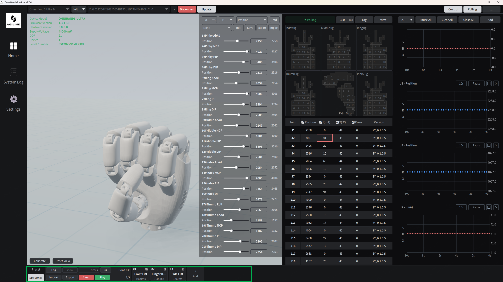

### Action Files

**Action library file (JSON):** imported/exported through the control column; defines individual actions. Each action contains the positions of the 21 joints, `pos_axis_1` to `pos_axis_21`. The example below uses Side Fist (`product_variant` is `H3UM_T1P5`, the 21-joint version):

```json
{
    "actions": [
        {
            "hand_type": "left",
            "name": "Side Fist",
            "pos_axis_1": 2260,
            "pos_axis_10": 4000,
            "pos_axis_11": 3400,
            "pos_axis_12": 2500,
            "pos_axis_13": 2048,
            "pos_axis_14": 4000,
            "pos_axis_15": 3400,
            "pos_axis_16": 2500,
            "pos_axis_17": 3500,
            "pos_axis_18": 4000,
            "pos_axis_19": 1200,
            "pos_axis_2": 4000,
            "pos_axis_20": 2795,
            "pos_axis_21": 2860,
            "pos_axis_3": 3400,
            "pos_axis_4": 2500,
            "pos_axis_5": 2048,
            "pos_axis_6": 4000,
            "pos_axis_7": 3400,
            "pos_axis_8": 2500,
            "pos_axis_9": 2152,
            "position_type": "encoder"
        },
        {
            "hand_type": "right",
            "name": "Side Fist",
            "pos_axis_1": 1836,
            "pos_axis_10": 4000,
            "pos_axis_11": 3400,
            "pos_axis_12": 2500,
            "pos_axis_13": 2048,
            "pos_axis_14": 4000,
            "pos_axis_15": 3400,
            "pos_axis_16": 2500,
            "pos_axis_17": 3500,
            "pos_axis_18": 4000,
            "pos_axis_19": 1200,
            "pos_axis_2": 4000,
            "pos_axis_20": 2795,
            "pos_axis_21": 2860,
            "pos_axis_3": 3400,
            "pos_axis_4": 2500,
            "pos_axis_5": 2048,
            "pos_axis_6": 4000,
            "pos_axis_7": 3400,
            "pos_axis_8": 2500,
            "pos_axis_9": 1944,
            "position_type": "encoder"
        }
    ],
    "format": "omnihand-actions",
    "product_type": "OMNIHAND_3_ULTRA_M",
    "product_variant": "H3UM_T1P5",
    "version": 3
}
```

**Action sequence file (JSON):** imported/exported through the Sequence tab. Steps can use preset gestures, individual actions from the action library, or actions loaded from a local file. Besides the interval `delay_ms`, each step records the hand `hand_type` and the positions of the 21 joints in `positions` (preset gesture steps too); `gesture_id` is the preset gesture number: 1 Front Fist, 2 Side Fist, 3 Finger Heart.

```json
{
    "format": "omnihand-sequence",
    "product_type": "OMNIHAND_3_ULTRA_M",
    "product_variant": "H3UM_T1P5",
    "sequence_name": "默认序列",
    "steps": [
        {
            "delay_ms": 1000,
            "gesture_id": 1,
            "hand_type": "left",
            "name": "Front Fist",
            "positions": [
                2260,
                4000,
                3400,
                2500,
                2048,
                4000,
                3400,
                2500,
                2152,
                4000,
                3400,
                2500,
                2048,
                4000,
                3400,
                2500,
                2626,
                1205,
                1200,
                2795,
                2860
            ],
            "source": "preset"
        },
        {
            "delay_ms": 1000,
            "gesture_id": 3,
            "hand_type": "left",
            "name": "Finger Heart",
            "positions": [
                2260,
                4000,
                3400,
                2500,
                2048,
                4000,
                3400,
                2500,
                2152,
                4000,
                3400,
                2500,
                2048,
                4096,
                1470,
                1349,
                3500,
                2506,
                1783,
                1542,
                771
            ],
            "source": "preset"
        },
        {
            "delay_ms": 1000,
            "gesture_id": 2,
            "hand_type": "left",
            "name": "Side Fist",
            "positions": [
                2260,
                4000,
                3400,
                2500,
                2048,
                4000,
                3400,
                2500,
                2152,
                4000,
                3400,
                2500,
                2048,
                4000,
                3400,
                2500,
                3500,
                4000,
                1200,
                2795,
                2860
            ],
            "source": "preset"
        }
    ],
    "version": 2
}
```

### Firmware Update

After connecting, click **Update** at the top of the window:

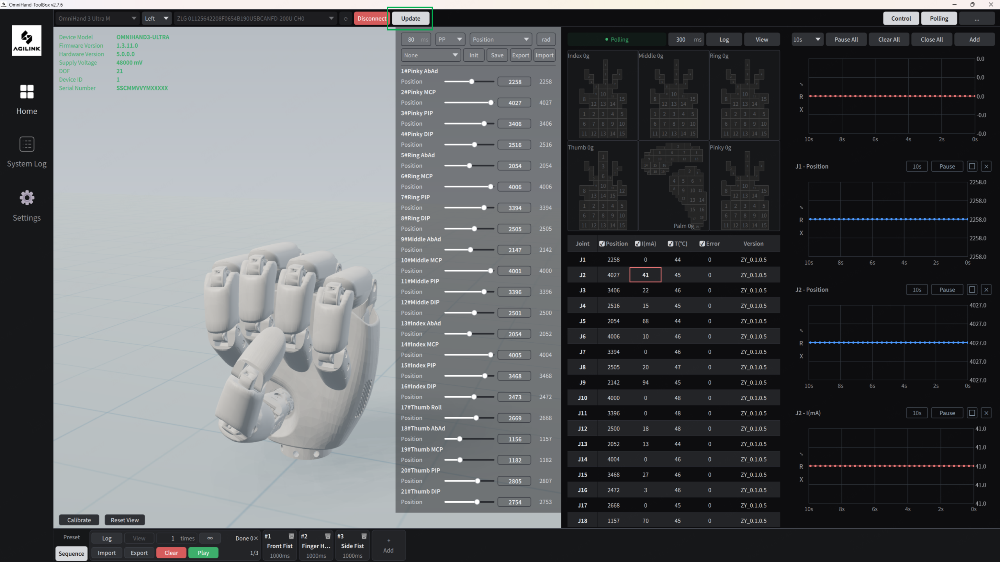

Click **Select** and choose the firmware file from a local folder. The update starts once the file is selected, and the page shows progress through Download, Request, Transfer, Finalize, Restart, and Complete:

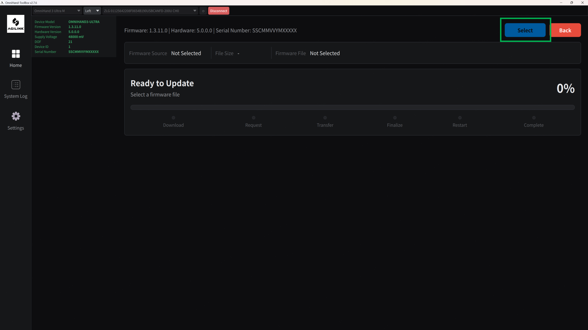

When progress reaches **100%** and the page shows **Update Complete** (the device has restarted and the connection is restored), click **Back** to return to the main interface:

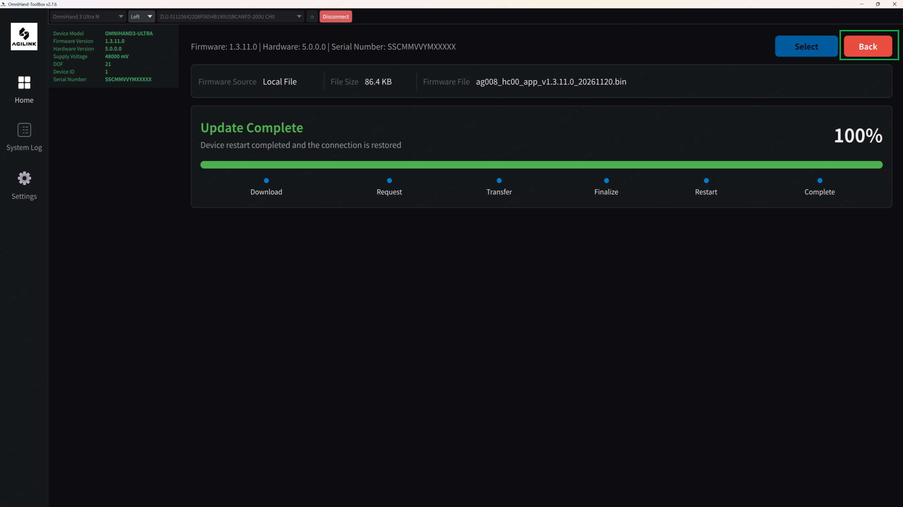

### System Log

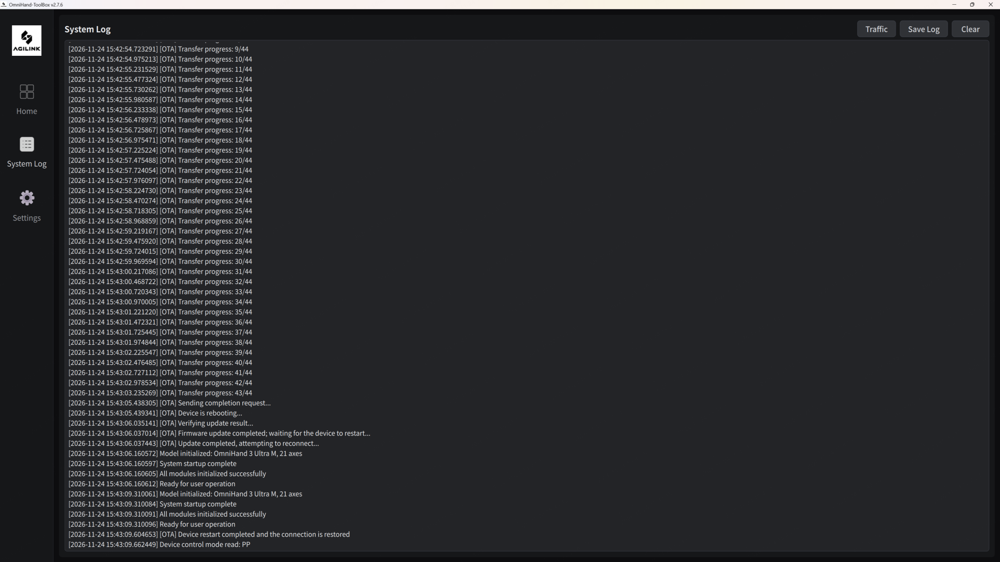

- **Traffic:** enable this switch to display transmitted and received messages.
- **Save Log:** export the log.
- **Clear:** clear the displayed log in the screen.

### Settings

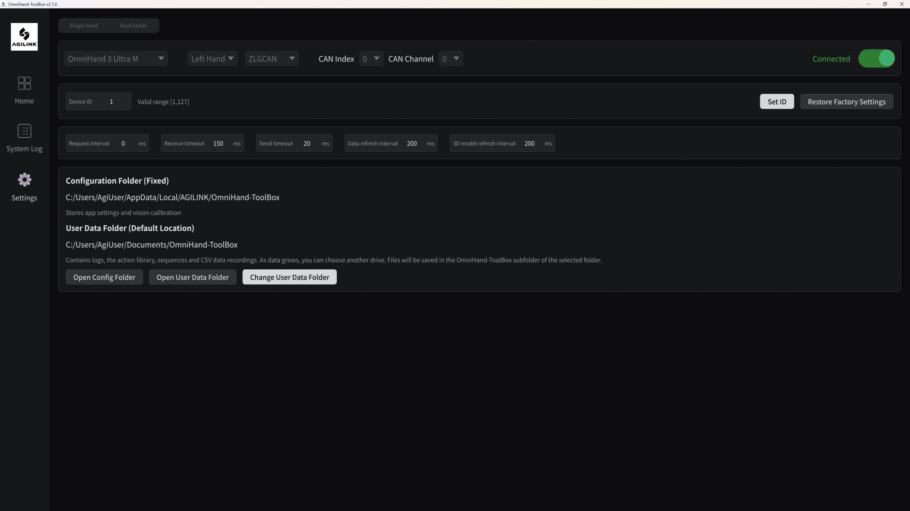

The top of the page has **Single hand** and **Dual hands** tabs, which are disabled while connected. For dual hand mode, see [Dual Hand Settings](#dual-hand-settings). The following describes single hand mode.

The settings page provides the full connection configuration:

- **Product:** select **OmniHand 3 Ultra M**, the model name of this product in the software.
- **Hand:** select right or left.
- **Connection type:** ZLGCAN or HCAN (both CAN FD). SocketCAN is also available on Linux. The parameter area changes with the selected connection type.
- **Connection parameters:** for CAN FD, set the adapter index and channel to match the USB-to-CAN FD adapter (defaults: `0 / 0`).
- **Connection switch:** connect or disconnect using the switch on the right. The adjacent status text indicates disconnected, connecting, connection failed, or connected.
- **CAN FD bus parameters:** the application applies the fixed values required by the communication protocol; no manual configuration is needed.

Once connected, the product, connection type, and connection parameters are disabled. Disconnect before changing them. The left/right hand selection remains available while connected.

You can also set the device ID to a value from **0x01 to 0x7F**, or restore the factory-default device ID.

Timing settings include:

- **Request interval:** the gap between successive requests (default 0 ms).
- **Receive timeout:** the maximum wait for a reply frame; the operation returns as soon as the reply is received (default 150 ms).
- **Send timeout:** the maximum time the underlying send or write operation may wait (default 20 ms).
- **Data refresh interval:** control how often the UI displays updated data (default 200 ms).
- **3D model refresh interval:** control how often the 3D model is updated (default 200 ms).

You can also open the configuration folder and the user data folder; **Change User Data Folder** moves where data is saved.

### Dual Hand Settings

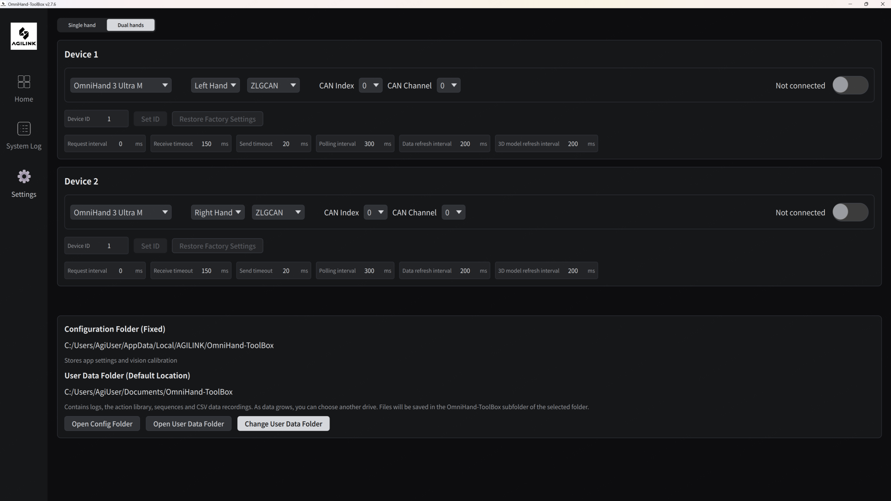

Select **Dual hands** at the top of the settings page first. Two groups, **Device 1** and **Device 2**, then appear. Each has its own product, hand, connection type, CAN index and channel, device ID, and timing settings, and its own connection switch. If both hands are connected to the same two-channel CAN adapter, set the CAN channel of the two groups to 0 and 1 respectively.

Besides the timing settings of single hand mode, each device also has a **Polling interval** (default 300 ms).

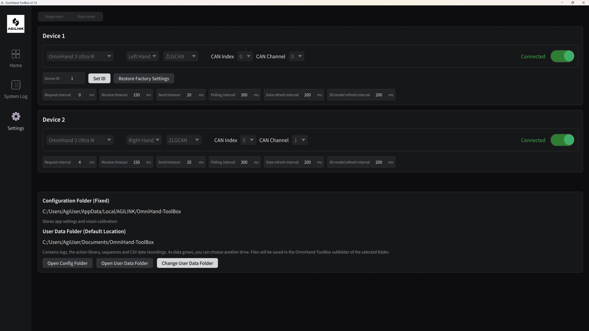

When both hands are connected, the switch on the right of each group shows **Connected** in green.

### Dual Hand Mode

The application can control two hands at the same time. After selecting **Dual hands** in [Dual Hand Settings](#dual-hand-settings), the main interface shows two devices.

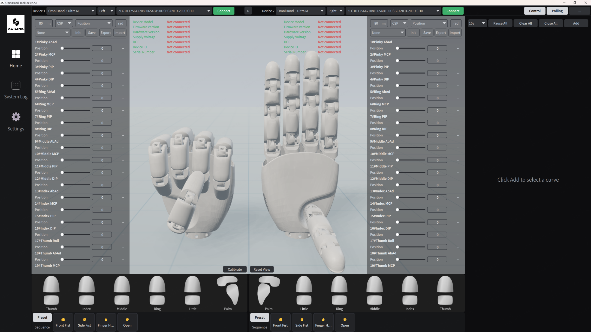

1. Two connection areas, **Device 1** and **Device 2**, appear at the top. Select the product (**OmniHand 3 Ultra M**), hand, and CAN adapter for each.
2. Open a device dropdown to see the CAN adapters and channels detected on the computer, for example `ZLG ...USBCANFD-200U CH0` and `CH1`. **Select the device and channel that match each hand**: Device 1 and Device 2 correspond to the left and right hands you want to control. Choosing the wrong one swaps the control between the two hands.

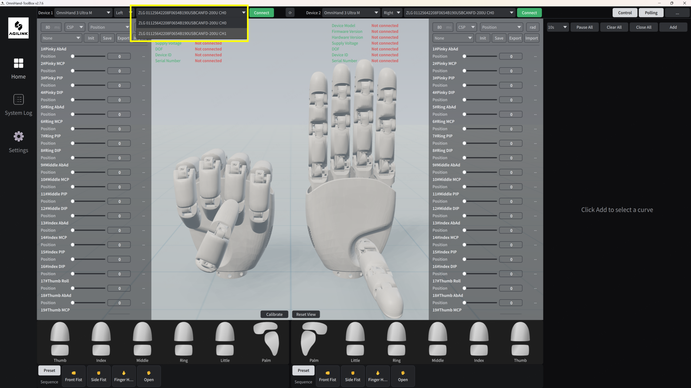

3. Click **Connect** for each device.

#### Dual Hand Layout

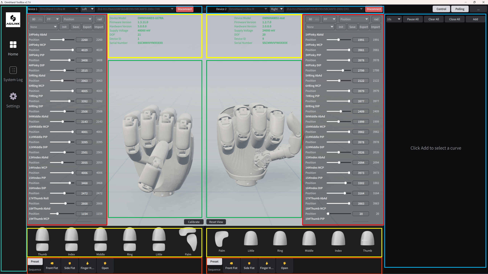

After both hands connect, they are shown side by side. Each hand has:

- its own connection bar and device information at the top;
- its own control column;
- a 3D model (both models share the view; **Calibrate** and **Reset View** are at the bottom center);
- a row of tactile readings below the model (Thumb, Index, Middle, Ring, Little, and Palm);
- its own **Preset** and **Sequence** bar at the bottom.

The curve column on the right is shared by both hands.

#### More Menu

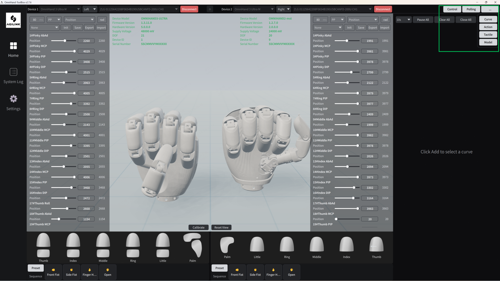

The **Control** and **Polling** buttons and the **...** menu at the upper right work like the single-hand [Display Switches](#display-switches). In dual hand mode, the **...** menu contains **Curve**, **Action**, **Tactile**, and **Model**.

#### Adding Curves

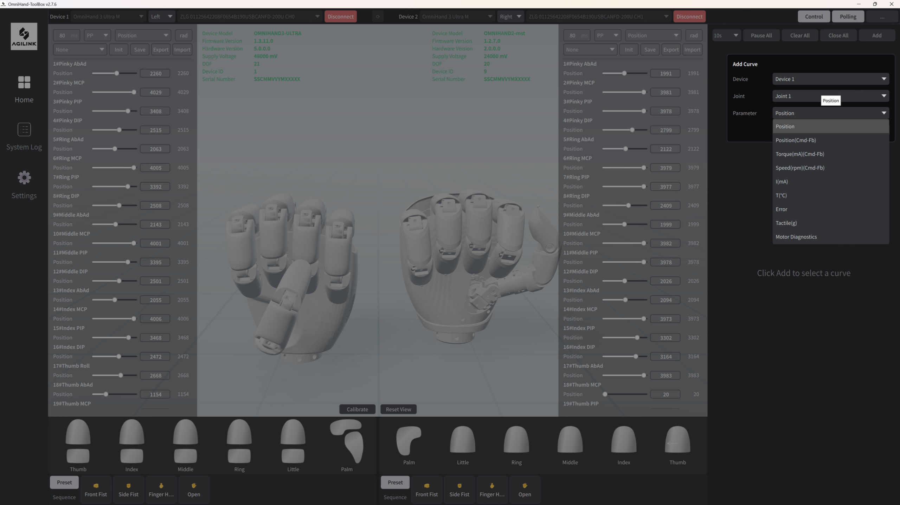

When no curve is shown, the column displays "Click Add to select a curve". Click **Add** in the curve column. In the **Add Curve** dialog, choose:

- **Device:** Device 1 or Device 2, that is, which hand's curve to view.
- **Joint:** the joint of that device.
- **Parameter:** Position, Position (Cmd-Fb), Torque (mA) (Cmd-Fb), Speed (rpm) (Cmd-Fb), I (mA), T (°C), Error, Tactile (g), or Motor Diagnostics.

The curve is then added for that device.

#### Preset Actions

Each hand has its own preset action bar at the bottom of the window. Click each one independently; they do not affect each other. The gestures are the same as in single hand mode (see [Action Configuration](#action-configuration)).

#### Real-Time Curves

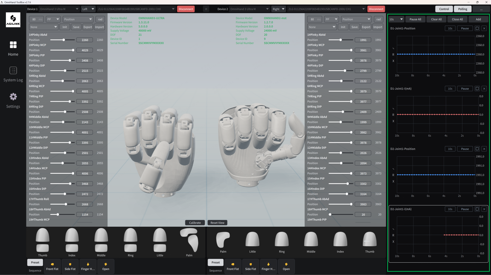

Both hands' curves can be viewed at the same time. In the chart names, **D1** and **D2** stand for Device 1 and Device 2, for example `D1-Joint1-Position`.

#### Action Sequence

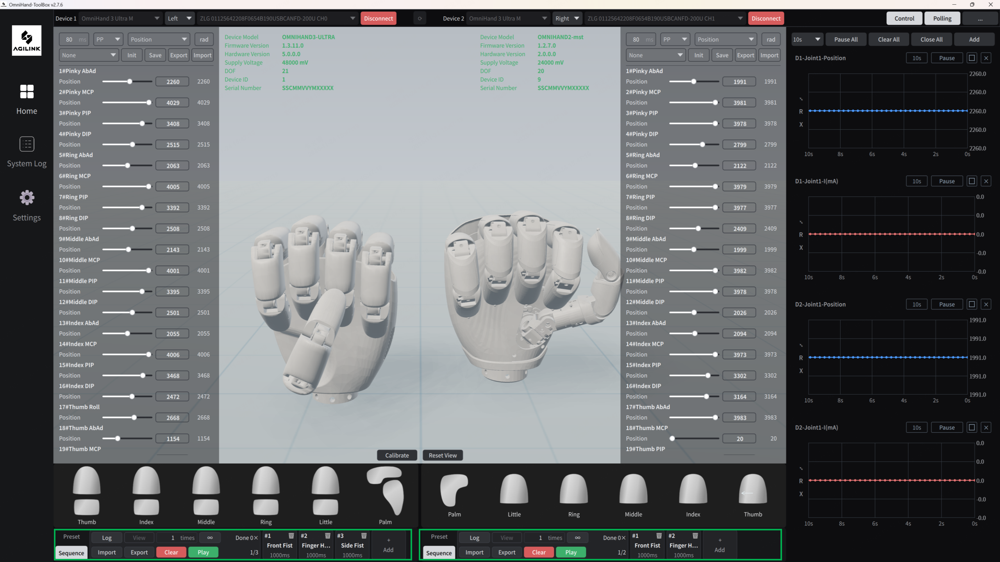

Each hand has its own **Sequence** bar, so each hand can have its own sequence. Usage is the same as in single hand mode (see [Action Configuration](#action-configuration)).

#### Calibrate and Reset View

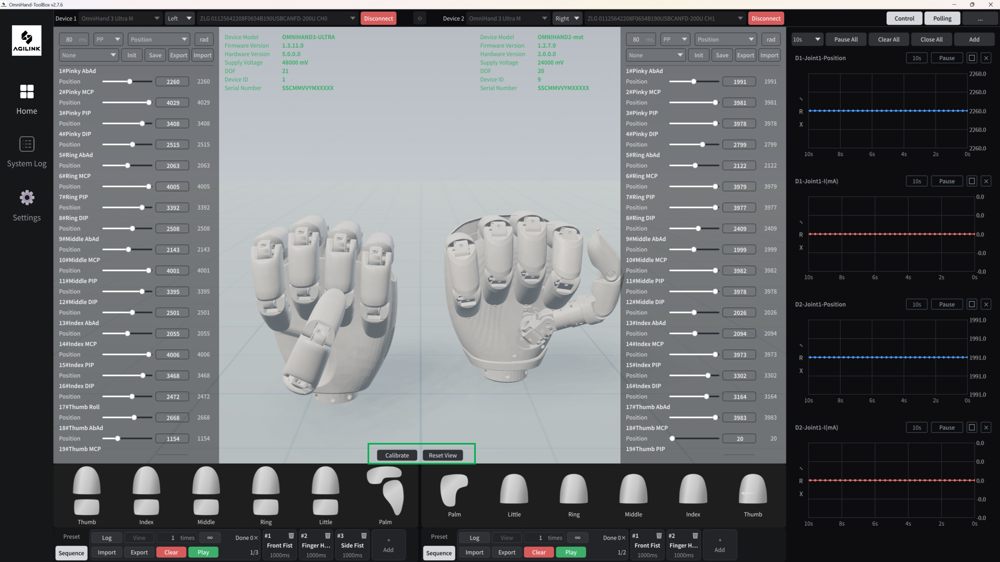

**Calibrate** and **Reset View** at the bottom center of the 3D area work the same as in single hand mode (see [3D Hand Model](#3d-hand-model)).
