# OmniHand 3 Ultra M 用户指南

[English](omnihand_3_ultra_m_guide.md)

本指南以 21 个主动关节的 OmniHand 3 Ultra M 为例（连接成功后设备信息中的`自由度`显示为 21）。

## 登录

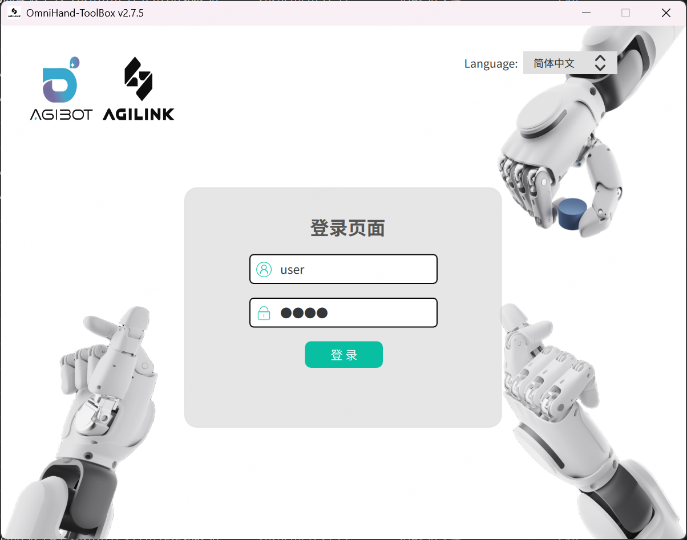

窗口标题栏显示上位机软件版本，如`OmniHand-ToolBox v2.7.6`。

页面右上角可调整界面语言，目前支持**简体中文**和**English**。

点击`登录`按钮直接进入用户主界面，用户名和密码默认为`user`（无需修改）。

## 主界面

登录后进入主界面：

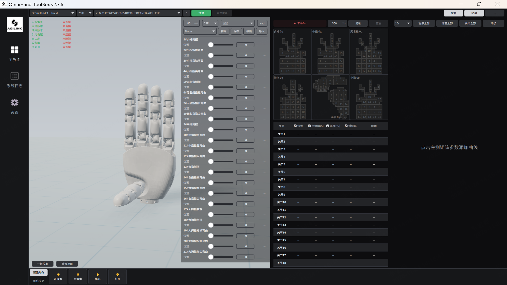

### 主界面布局

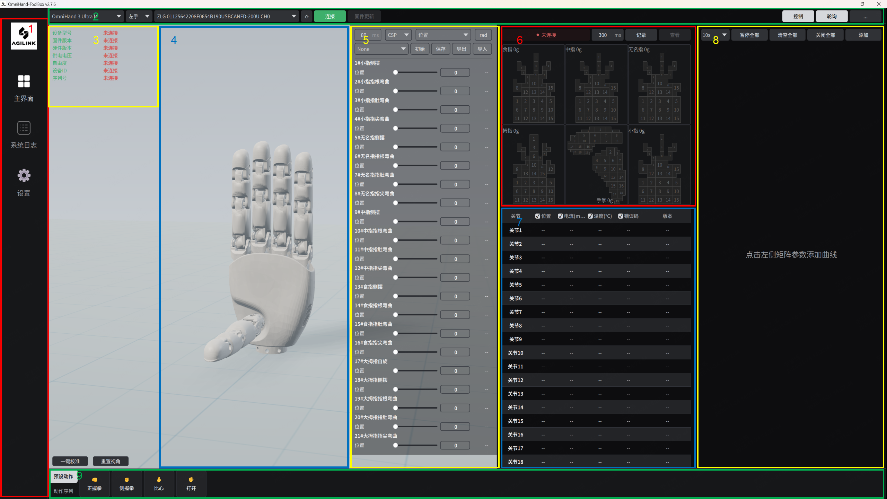

主界面窗口分为9个区域：

**1. 导航栏**：主界面、[系统日志](#系统日志)、[设置](#设置)。

**2. 连接和布局**：产品型号与左右手选择、设备选择、连接/断开按钮、连接后可用的固件更新按钮（见[快速连接与设备状态](#快速连接与设备状态)、[固件更新](#固件更新)），以及右侧的显示开关（见[显示开关](#显示开关)）。

**3. 设备状态**：设备信息（见[快速连接与设备状态](#快速连接与设备状态)）。

**4. 手部模型**：3D外观，实时位置联动；左下角有一键校准、重置视角按钮（见[3D手部模型](#3d手部模型)）。

**5. 控制栏**：控制模式、控制类型设置，原子动作导入导出，以及 21 个关节的位置滑块（见[关节控制](#关节控制)）。

**6. 触觉分布**：食指、中指、无名指、拇指、手掌、小指共 6 块区域的实时触觉数据；顶部为轮询状态、间隔与记录设置（见[触觉分布](#触觉分布)、[轮询与关节状态矩阵](#轮询与关节状态矩阵)）。

**7. 关节状态**：轮询参数选择、状态矩阵（见[轮询与关节状态矩阵](#轮询与关节状态矩阵)）。

**8. 曲线栏**：实时曲线显示和设置（见[实时曲线](#实时曲线)）。

**9. 动作配置**：预设动作、动作序列两个标签页（见[动作配置](#动作配置)）。

### 显示开关

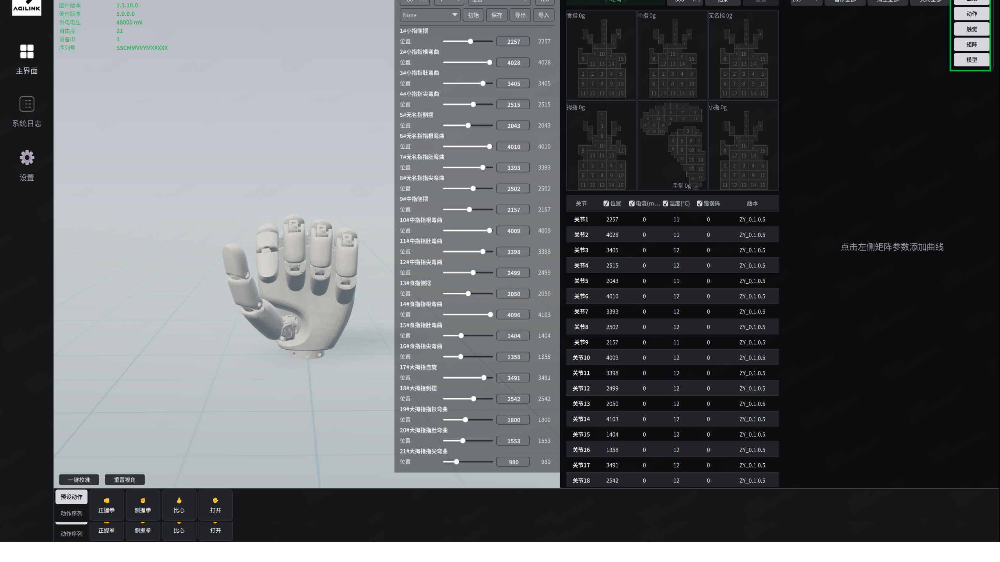

界面右上角有`控制`、`轮询`、`...`三个按钮，点击`...`可展开更多开关。以下所有开关高亮则表示对应区域显示，置灰则表示不显示：

**控制**：决定是否显示第⑤区域**控制栏**。

**轮询**：控制轮询的开启与关闭（见[轮询与关节状态矩阵](#轮询与关节状态矩阵)）。

`...`菜单中的开关：

**曲线**：决定是否显示第⑧区域**曲线栏**。

**动作**：决定是否显示第⑨区域**动作配置**。

**触觉**：决定是否显示第⑥区域**触觉分布**。

**矩阵**：决定是否显示第⑦区域**关节状态**的矩阵数据部分，位置、电流、温度、错误码等表头轮询参数选择保留始终显示。

**模型**：决定是否显示第④区域**手部模型**。


### 快速连接与设备状态

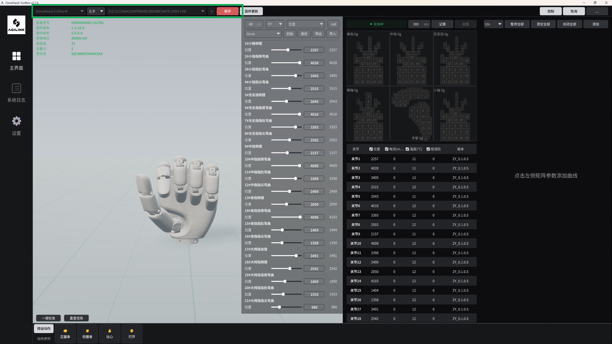

**1.** 用ZLG CAN或者HCAN将灵巧手接入电脑，然后接通OmniHand灵巧手电源（建议**48V**）。

**2.** 在设备下拉框中选择已识别到的 CANFD 设备（如`ZLG ...USBCANFD-200U CH0`）；若显示`未发现设备`，点击右侧 `⟳ `刷新。

**3.** 选择产品型号与左右手。本产品在产品下拉框中显示为 `OmniHand 3 Ultra M`。

**4.** 点击"连接"。握手成功后，设备信息区显示真实设备信息，绿色`连接`按钮变为红色的`断开`按钮，同时`固件更新`按钮由灰色变为可用。

***
如需设置更详细的连接参数（CAN 索引、通道等），可使用左侧导航的"[设置](#设置)"页。

若设备下拉框中始终显示`未发现设备`，点击右侧 `⟳ `刷新按钮也不显示，就需要考虑连接用的CAN盒是否正常。特别地，我们支持ZLG CAN或者HCAN；还支持Ubuntu上使用Socketcan，前提是安装了对应CAN卡的官方SocketCan驱动，并配置`1M@80% + 5M@75%`的参数。
***

连接成功时，设备状态如下图所示：

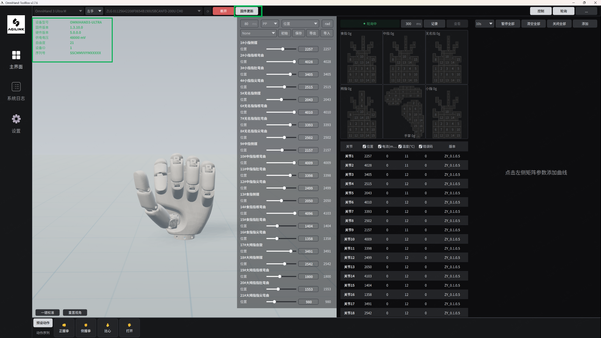

- 固件更新：位于顶部连接栏，点击后会跳转到[固件更新](#固件更新)页面。
- 设备信息：显示设备型号、固件版本、硬件版本、供电电压、自由度、设备 ID、序列号共 7 项。

未连接时，设备信息项均显示红色`未连接`：

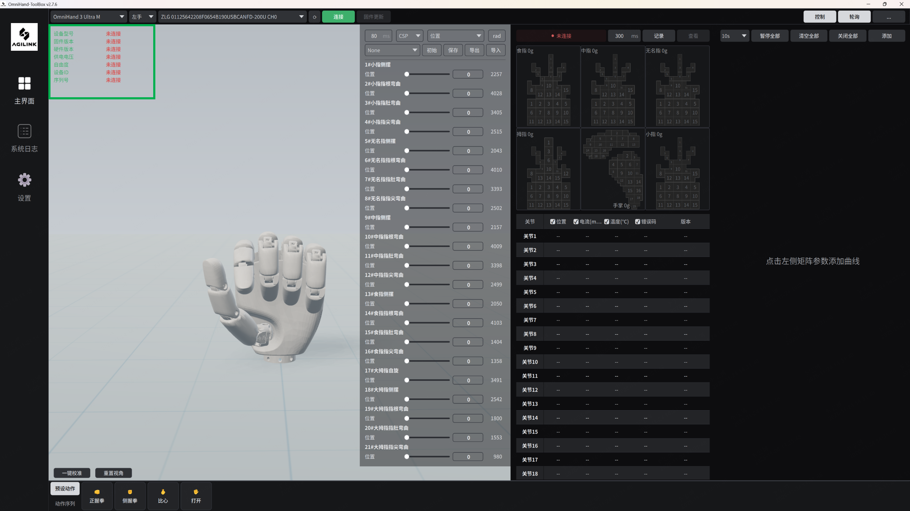

CAN盒正常连接，但设备通讯异常则显示黄色`未获取`（请检查设备是否正常供电，线束、接头是否接触良好，线序是否正确）：

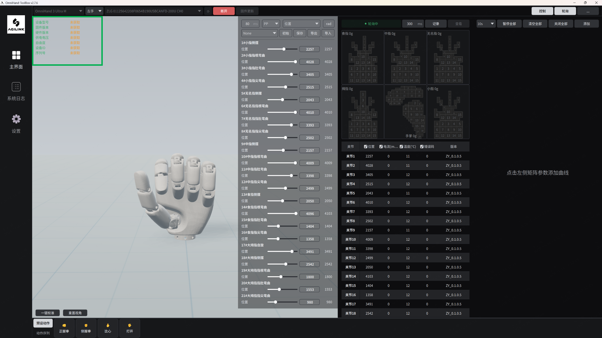

CAN盒连接异常（应该是CAN盒中途被拔出或者接触不良）：

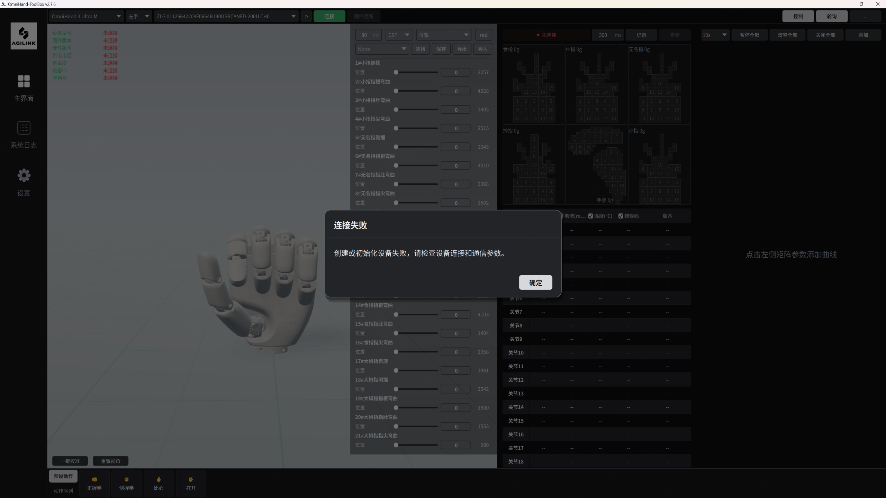


### 轮询与关节状态矩阵

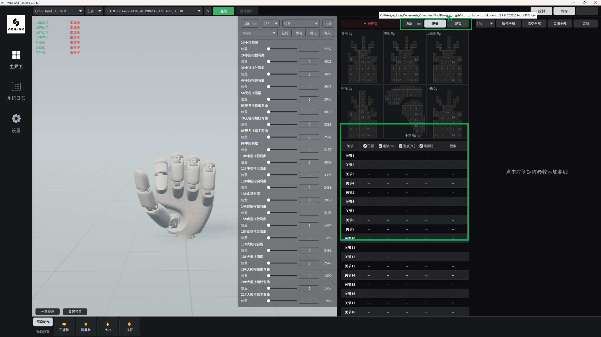

**轮询**：开启后软件按设定周期向灵巧手读取上述数据；关闭后停止发送周期读取请求，矩阵停留在最后一次读到的数值，不再刷新。

**间隔(ms)**：轮询周期，默认 300 ms，修改后按回车生效。周期越短总线负载越高，一般保持默认值即可。

**记录**：开启会将轮询数据持续写入一个CSV文件。

**查看**：鼠标悬浮此处可以看到**记录**CSV的具体文件路径，点击此按钮可以打开对应文件夹。

**关节状态矩阵**：按关节逐行显示位置、电流(mA)、温度(℃)、错误码和版本五项数据，共 21 个关节。未连接时各项显示"--"。其中**版本**为该关节的版本号（如`ZY_0.1.0.5`）。

***
关节状态矩阵的表头包含位置、电流、温度和错误码的勾选框，可以自由地选择是否加入轮询队列；`...`菜单中的`触觉`开关除了控制触觉区域的显示，还会决定触觉是否加入轮询队列。

点击矩阵中的某个参数单元格，可将该关节的该项数据直接添加为一条实时曲线（见[实时曲线](#实时曲线)）。
***

### 实时曲线

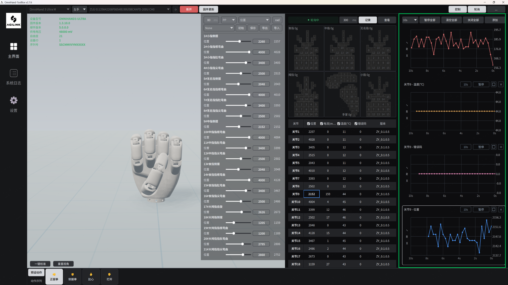

顶部配置行：

**时间窗下拉框**：横轴显示时长，可在 1 秒到 5 分钟的若干档位中选择。

**暂停全部 / 继续全部**：暂停或恢复所有曲线的刷新。

**清空全部**：清空所有曲线已绘制的数据。

**关闭全部**：关闭所有正在显示的曲线卡片。

**添加**：弹出"添加曲线"对话框，选择关节与参数后新增一条曲线。可选参数为关节的位置、位置(指令-反馈)、力矩(mA)(指令-反馈)、速度(rpm)(指令-反馈)、电流(mA)、温度(℃)、错误码、电机诊断；选择触觉(g)时改为按手指 / 手掌区域选择。


***
如果轮询关闭或者对应参数取消勾选，该项数据停止更新，对应轮询数据曲线冻结。

曲线区为空时显示提示"点击左侧矩阵参数添加曲线"。点击矩阵对应方格，也可显示曲线。
***

曲线卡片按键设定：

**拖动**：左侧三个按键中第一个，只在小卡片模式下显示，点中后可以用来调整不同卡片的相对位置。

**重置**：左侧三个按键中的第二个，即**R**键，可以重置曲线横轴和纵轴的缩放到默认状态，快捷键为**Ctrl+R**。

**清除**：左侧三个按键中的第三个，即**X**键，可以清除已经绘制的数据，重新开始绘制。

**时间窗下拉框**：位置卡片右上角，效果同曲线栏顶部的时间窗下拉框，只不过该下拉框只影响当前卡片。同时这里还有悬浮提示，指定了横轴放大缩小、纵轴放大缩小、横轴平移和纵轴平移的快捷键。

**暂停 / 恢复**：暂停或恢复曲线的刷新。

**最大化 / 还原**：用于最大化曲线卡片为整个窗口，或者将曲线窗口还原为卡片。

将鼠标移到目标曲线上后，可使用以下快捷键：

| 快捷键 | 功能 |
| --- | --- |
| Ctrl + ↑ / ↓ | 放大 / 缩小 Y 轴 |
| Ctrl + → / ← | 放大 / 缩小 X 轴 |
| Ctrl + Shift + ↑ / ↓ | 纵向平移 |
| Ctrl + Shift + ← / → | 暂停后横向平移 |
| Ctrl + R | 重置视图 |

点击曲线图例可切换对应曲线的显示，鼠标悬浮到绘图区可查看数值。暂停曲线只冻结视图，采集仍在继续；只有停止**轮询**才会停止周期采集。

### 关节控制

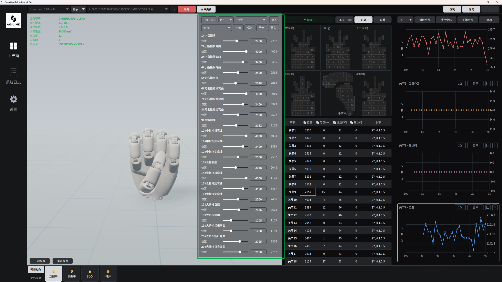

**防抖**：设置滑块输入数据的采样间隔（默认 80 ms），避免持续输入高负荷占用CAN FD总线带宽。

**控制模式**：本产品支持 CSP 和 PP 两种位置控制模式。连接后会读取并显示灵巧手当前的控制模式。

| 模式 | 说明 |
|---|---|
|CSP|循环同步位置模式：上位机以固定周期连续下发目标位置，适合拖动滑块等需要连续跟随的场景|
|PP|轮廓位置模式：下发目标位置后，由灵巧手按内部规划运动到目标位置|

**控制类型**：控制模式右侧的下拉框，默认为"位置"，另有"位置+力矩"一项：

| 类型 | 下发参数 | 说明 |
|---|----|--|
|位置|电机编码位置|默认类型，只控制关节目标位置|
|位置+力矩|位置、力矩(mA)|在位置基础上限制关节运动的力矩电流，每个关节会多出一个`力矩(mA)`滑块，力矩范围 0–2000 mA，默认 1900 mA|

**rad**：默认不选中置灰，代表当前滑块或输入框使用电机编码值；选中后高亮，当前滑块或者输入框使用角度rad输入控制指令，保存动作时也会保存rad角度。

**动作下拉框**：列出当前左 / 右手可用的自定义动作，选中后各滑块跳到该动作保存的位置，并向灵巧手下发动作指令。首项"None"表示不选择任何动作。在列表中右键某一行，或点击悬停时出现的 ✕，可删除该动作。

**初始**：让所有关节一次性回到连接时的初始位置。

**保存**：将当前所有滑块位置保存为一个自定义动作，点击后输入动作名称即可；无论哪只手连接，保存结果都会保留左右手两份互为镜像动作；保存后出现在**动作下拉框**列表中。此时如果想导出文件，需配合"导出"。

**导出**：把动作方案中的全部自定义动作导出为一个 .json 文件（见[动作文件](#动作文件)）。

**导入**：从 .json 文件读取动作并写入动作方案。若文件中存在同名动作，导入前会弹出确认框列出将被覆盖的动作。

**关节滑块**：每个关节一行，行首为该关节的编号与名称，下方是参数滑块、目标值输入框与当前反馈值。拖动滑块即可实时控制该关节；也可在输入框中输入目标位置后按回车生效。21 个关节按手指依次排列：

| 编号 | 关节 | 编号 | 关节 | 编号 | 关节 |
|---|---|---|---|---|---|
|1|小指侧摆|8|无名指指尖弯曲|15|食指指肚弯曲|
|2|小指指根弯曲|9|中指侧摆|16|食指指尖弯曲|
|3|小指指肚弯曲|10|中指指根弯曲|17|大拇指自旋|
|4|小指指尖弯曲|11|中指指肚弯曲|18|大拇指侧摆|
|5|无名指侧摆|12|中指指尖弯曲|19|大拇指指根弯曲|
|6|无名指指根弯曲|13|食指侧摆|20|大拇指指肚弯曲|
|7|无名指指肚弯曲|14|食指指根弯曲|21|大拇指指尖弯曲|


### 3D手部模型

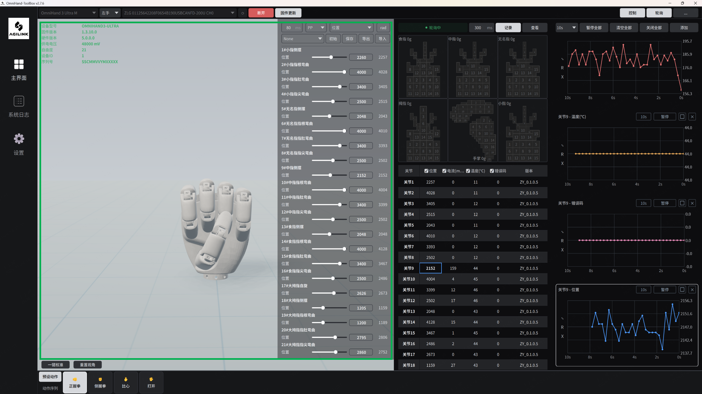

连接后模型随各关节实时姿态同步转动，可用鼠标旋转、缩放、平移视角。不需要时可在`...`菜单中关闭`模型`开关，把空间让给曲线与触觉区域。

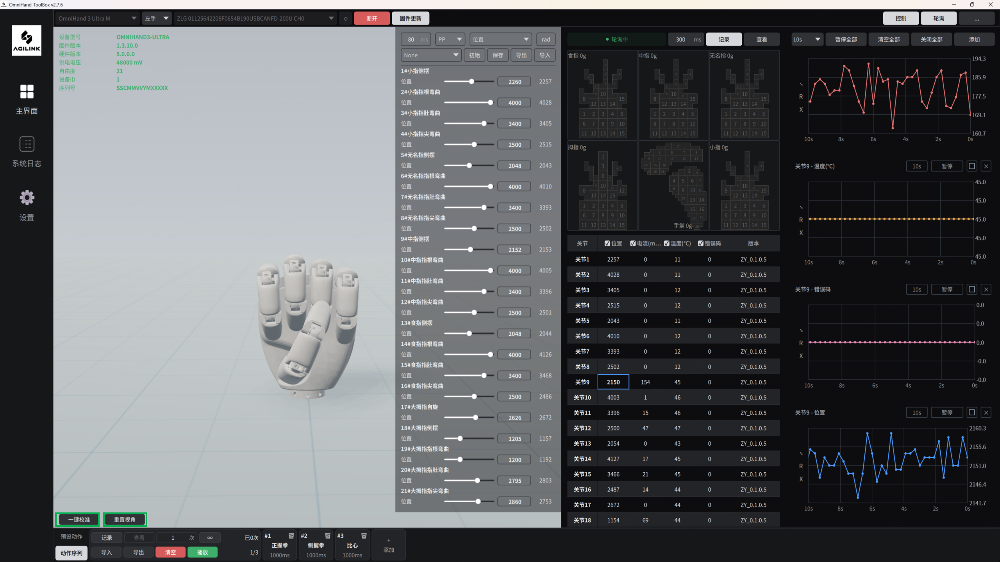

**一键校准**：恢复灵巧手和模型的姿势为默认手势。

**重置视角**：恢复默认视角。

### 触觉分布

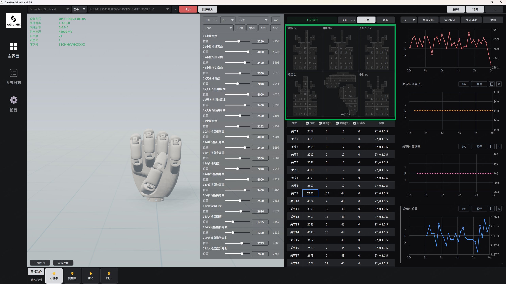

在`...`菜单中开启`触觉`后（默认开启，按钮高亮），该区域显示实时触觉数据，不需要时可关闭`触觉`将其隐藏。

显示方式：

- 分区布局：食指、中指、无名指、拇指、手掌、小指共 6 块区域，各区域标题处显示该区域名称和当前受力的合计值（单位 g），例如`食指 0g`。
- 测点图：每块区域按传感器的实际形状排布测点，图中的数字为测点编号，每根手指 30 个测点，手掌 38 个测点。

***
触觉数据是否刷新，取决于`触觉`开关是否开启（见[轮询与关节状态矩阵](#轮询与关节状态矩阵)）。
***

### 动作配置

动作配置区上方有两个标签页：

**预设动作**

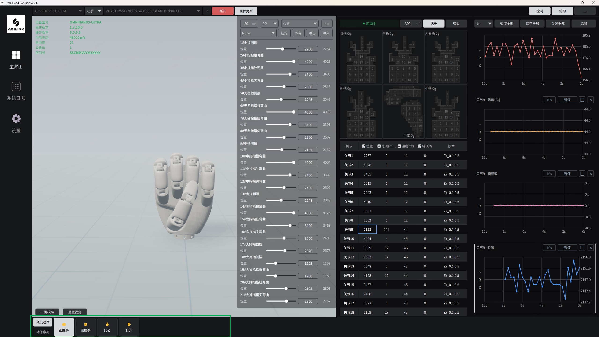

列出 SDK 内置的固定手势，共 4 个：正握拳、侧握拳、比心、打开。点击任一按钮即可让灵巧手快速摆出对应姿态，内置手势不可修改。

**动作序列**

用于把多个已保存动作组成一组循环执行：

- 点击 `+` 新增一个动作卡片：点击该卡片名称会弹出编辑对话框，在其动作下拉框中选择一个动作，并填写该动作执行后的间隔时间（单位 ms）。

- `记录`：选中按钮高亮后，开始动作时会把运行数据写入 CSV 文件。

- `查看`：鼠标悬浮此处可以看到**记录**CSV的具体文件路径，点击此按钮可以打开对应文件夹。

- `次数`：可以在编辑框中输入次数，也可以选中 `∞` 一直重复执行；右侧会显示重复执行完成次数。

- `导入`：外部导入动作序列json文件（见[动作文件](#动作文件)）。

- `导出`：将现在动作序列导出到本地json文件。

- `清空`：清空右侧所有的动作卡片，有时候导入的序列太长，逐个删除动作卡片就很浪费时间，可以用此按钮一键清除。

- `播放 / 停止`：按步骤顺序执行序列，也可以手动停止；右侧会显示当前执行到第几步。

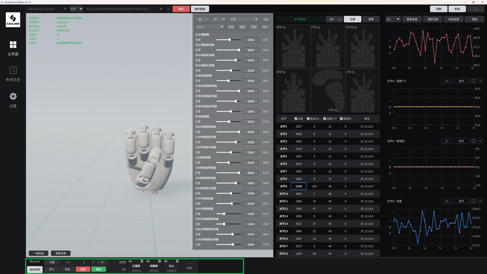


### 动作文件

**动作库文件(JSON)**：由控制栏导入导出，定义原子动作。每个动作包含 21 个关节的位置`pos_axis_1`～`pos_axis_21`，下面以"侧握拳"为例（`product_variant`为`H3UM_T1P5`，表示 21 个关节的版本）：

```json
{
    "actions": [
        {
            "hand_type": "left",
            "name": "侧握拳",
            "pos_axis_1": 2260,
            "pos_axis_10": 4000,
            "pos_axis_11": 3400,
            "pos_axis_12": 2500,
            "pos_axis_13": 2048,
            "pos_axis_14": 4000,
            "pos_axis_15": 3400,
            "pos_axis_16": 2500,
            "pos_axis_17": 3500,
            "pos_axis_18": 4000,
            "pos_axis_19": 1200,
            "pos_axis_2": 4000,
            "pos_axis_20": 2795,
            "pos_axis_21": 2860,
            "pos_axis_3": 3400,
            "pos_axis_4": 2500,
            "pos_axis_5": 2048,
            "pos_axis_6": 4000,
            "pos_axis_7": 3400,
            "pos_axis_8": 2500,
            "pos_axis_9": 2152,
            "position_type": "encoder"
        },
        {
            "hand_type": "right",
            "name": "侧握拳",
            "pos_axis_1": 1836,
            "pos_axis_10": 4000,
            "pos_axis_11": 3400,
            "pos_axis_12": 2500,
            "pos_axis_13": 2048,
            "pos_axis_14": 4000,
            "pos_axis_15": 3400,
            "pos_axis_16": 2500,
            "pos_axis_17": 3500,
            "pos_axis_18": 4000,
            "pos_axis_19": 1200,
            "pos_axis_2": 4000,
            "pos_axis_20": 2795,
            "pos_axis_21": 2860,
            "pos_axis_3": 3400,
            "pos_axis_4": 2500,
            "pos_axis_5": 2048,
            "pos_axis_6": 4000,
            "pos_axis_7": 3400,
            "pos_axis_8": 2500,
            "pos_axis_9": 1944,
            "position_type": "encoder"
        }
    ],
    "format": "omnihand-actions",
    "product_type": "OMNIHAND_3_ULTRA_M",
    "product_variant": "H3UM_T1P5",
    "version": 3
}
```

**动作序列文件(JSON)**：由配置动作区动作序列导入导出，其卡片元素可以使用预设动作\动作库的原子动作或者本地文件导入动作。每一步除间隔时间`delay_ms`外，还会记录手别`hand_type`和 21 个关节的位置`positions`（预设手势的步骤同样如此），其中`gesture_id`为预设手势编号：1 正握拳、2 侧握拳、3 比心。

```json
{
    "format": "omnihand-sequence",
    "product_type": "OMNIHAND_3_ULTRA_M",
    "product_variant": "H3UM_T1P5",
    "sequence_name": "默认序列",
    "steps": [
        {
            "delay_ms": 1000,
            "gesture_id": 1,
            "hand_type": "left",
            "name": "正握拳",
            "positions": [
                2260,
                4000,
                3400,
                2500,
                2048,
                4000,
                3400,
                2500,
                2152,
                4000,
                3400,
                2500,
                2048,
                4000,
                3400,
                2500,
                2626,
                1205,
                1200,
                2795,
                2860
            ],
            "source": "preset"
        },
        {
            "delay_ms": 1000,
            "gesture_id": 2,
            "hand_type": "left",
            "name": "侧握拳",
            "positions": [
                2260,
                4000,
                3400,
                2500,
                2048,
                4000,
                3400,
                2500,
                2152,
                4000,
                3400,
                2500,
                2048,
                4000,
                3400,
                2500,
                3500,
                4000,
                1200,
                2795,
                2860
            ],
            "source": "preset"
        },
        {
            "delay_ms": 1000,
            "gesture_id": 3,
            "hand_type": "left",
            "name": "比心",
            "positions": [
                2260,
                4000,
                3400,
                2500,
                2048,
                4000,
                3400,
                2500,
                2152,
                4000,
                3400,
                2500,
                2048,
                4096,
                1470,
                1349,
                3500,
                2506,
                1783,
                1542,
                771
            ],
            "source": "preset"
        }
    ],
    "version": 2
}
```

### 固件更新

连接成功后，点击顶部的`固件更新`按钮：

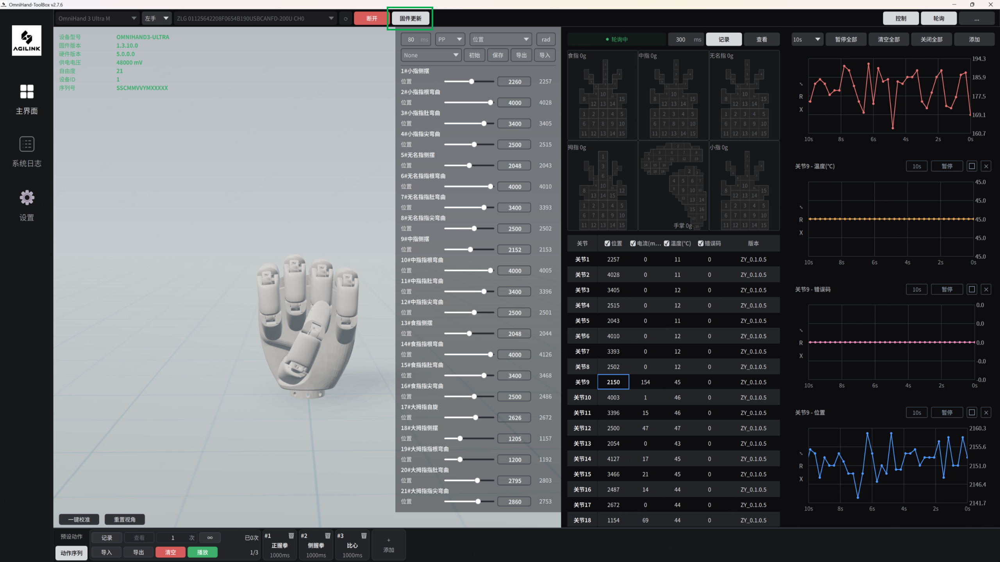

点击`选择固件`按钮选择本地文件夹中的固件，选择后即开始更新，页面会依次显示下载、请求、传输、收尾、重启、完成各阶段：

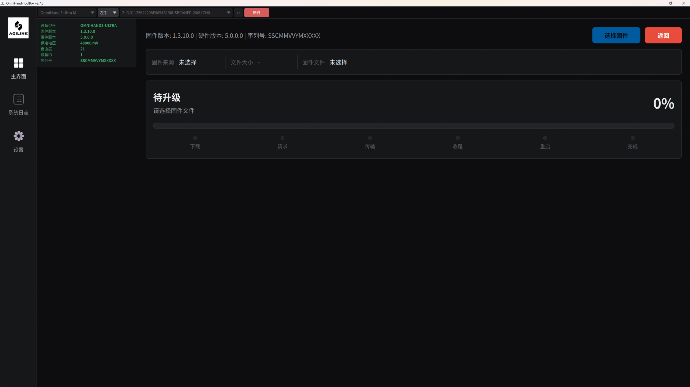

等待更新进度达到100%，显示`升级完成`（设备重启完成，连接已恢复）后，点击`返回`按钮回到主界面：

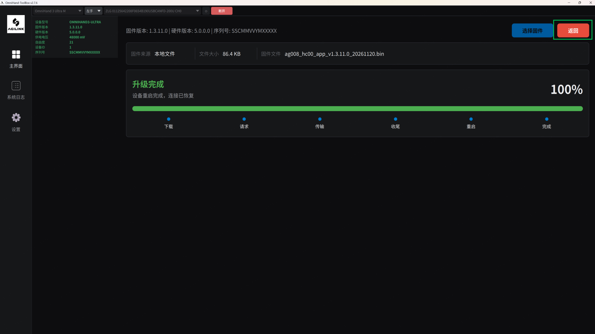

### 系统日志

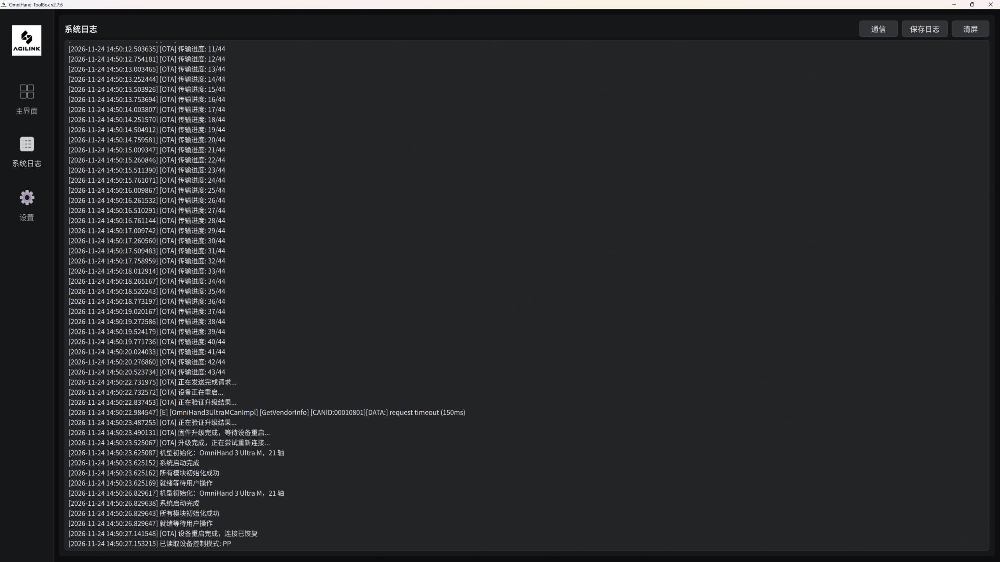

**通信** 后可查看收发报文。

**保存日志** 导出日志，

**清屏** 清除显示内容。

### 设置

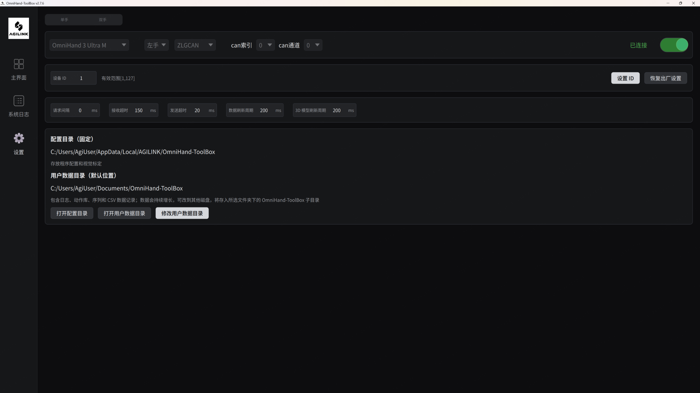

设置页顶部可切换`单手`和`双手`模式（连接后置灰不可切换），双手模式见[双手设置](#双手设置)。以下为单手模式的设置。

提供完整的连接参数配置：

- 产品：选择 "OmniHand 3 Ultra M"，即本产品在软件中的型号名称。
- 左右手：右手 / 左手。
- 连接方式：ZLGCAN、HCAN（均为 CAN-FD 方式）；Linux 下另有 SocketCAN。选择不同方式时，右边的参数区会随之切换。
- 连接参数：CAN-FD 方式填 can 索引 / can 通道，与所用 USB-CANFD 盒保持一致（默认 0 / 0）。
- 右侧开关用于连接 / 断开，左边的文字显示当前状态："未连接""连接中…""连接失败"或"已连接"。
- CAN-FD 通信参数由软件按通讯协议约定的固定值下发，无需手动设置。

连接成功后，产品、连接方式与连接参数会置灰不可改，需要修改时先断开连接；左右手在连接状态下仍可切换。

允许设置设备ID：

- 指定ID范围0x01-0x7F
- 也可以恢复出厂默认设备ID

允许设置各种时间间隔：

- 请求间隔：两条发送指令之间的时间间隔（默认 0 ms）。
- 接收超时：等待回复帧的最长时间，收到回复即返回（默认 150 ms）。
- 发送超时：底层发送或写入允许等待的最长时间（默认 20 ms）。
- 数据刷新周期：用于UI更新频率控制（默认 200 ms）。
- 3D 模型刷新周期：用于控制模型更新频率（默认 200 ms）。

此外，还可以打开或者设置配置目录和用户数据目录，`修改用户数据目录`可以更换数据保存位置。

### 双手设置

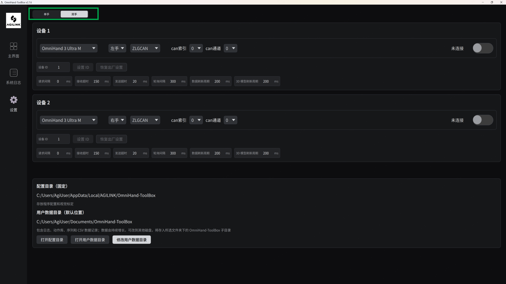

在设置页顶部选择`双手`后，页面出现`设备1`和`设备2`两组配置，各自设置产品、左右手、连接方式、can 索引/通道、设备ID 和时间间隔，并各有一个连接开关。如果两只手接在同一个双通道 CAN 盒上，两组设备的 can 通道需分别设为 0 和 1。

两组设备除单手设置中的时间间隔外，还额外提供**轮询间隔**（默认 300 ms）。

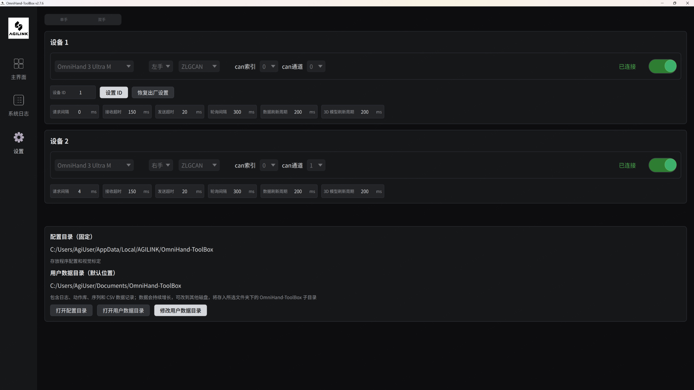

两只手都连接成功后，两组设备右侧的开关均显示为绿色`已连接`。

### 双手模式

上位机支持同时连接两只灵巧手。先按[双手设置](#双手设置)在设置页顶部选择`双手`，主界面就会显示两套设备。

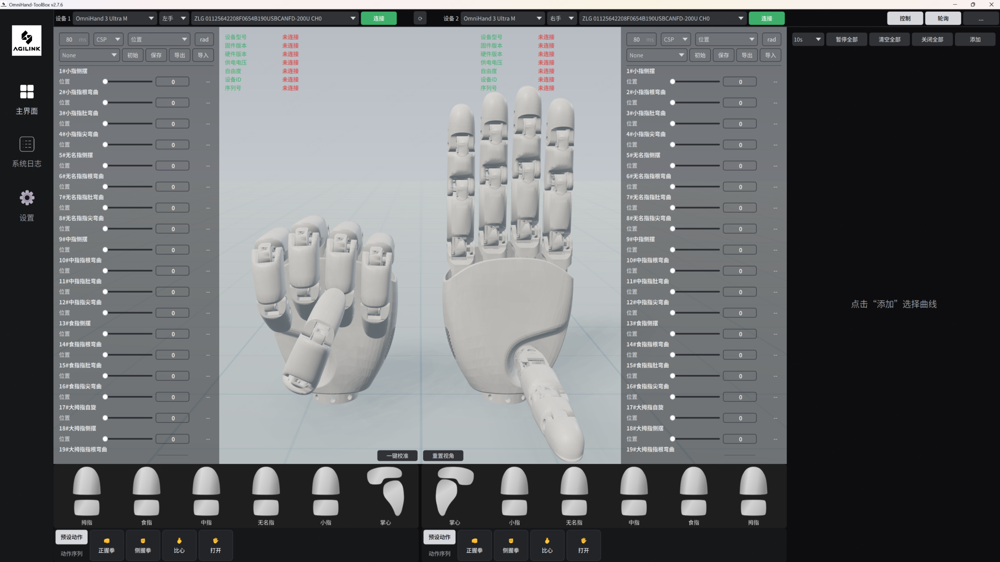

**1.** 顶部出现`设备1`和`设备2`两个连接区，分别选择产品型号（`OmniHand 3 Ultra M`）、左右手和 CAN 设备。

**2.** 点击设备下拉框，会列出电脑上识别到的 CAN 设备及通道（如`ZLG ...USBCANFD-200U CH0`、`CH1`）。**请按左右手选择对应的设备和通道**：设备1、设备2 分别对应你要控制的左手和右手，选错会导致两只手控制颠倒。

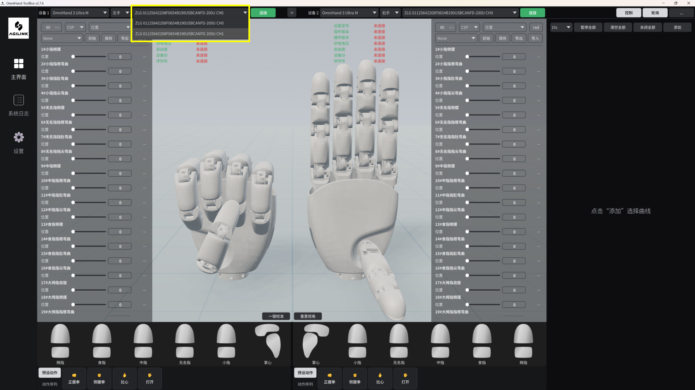

**3.** 两个设备分别点击`连接`。

#### 双手界面布局

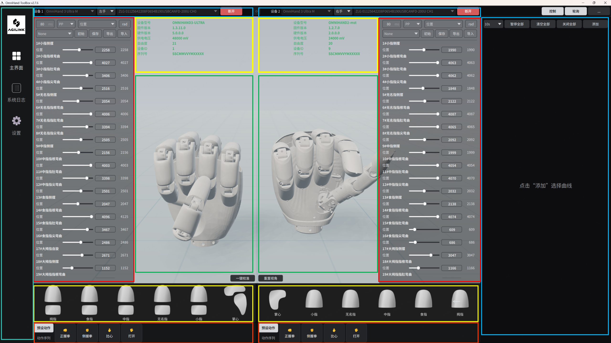

连接成功后，两只手左右并排显示，各自拥有：

- 顶部的连接栏（设备1、设备2）和设备信息；
- 各自的控制栏；
- 3D 模型（两只手同屏显示，底部中间为`一键校准`、`重置视角`）；
- 模型下方的触觉显示（每只手一排，对应拇指、食指、中指、无名指、小指、掌心）；
- 底部各自的预设动作和动作序列栏。

最右侧为两只手共用的曲线栏。

#### 更多菜单

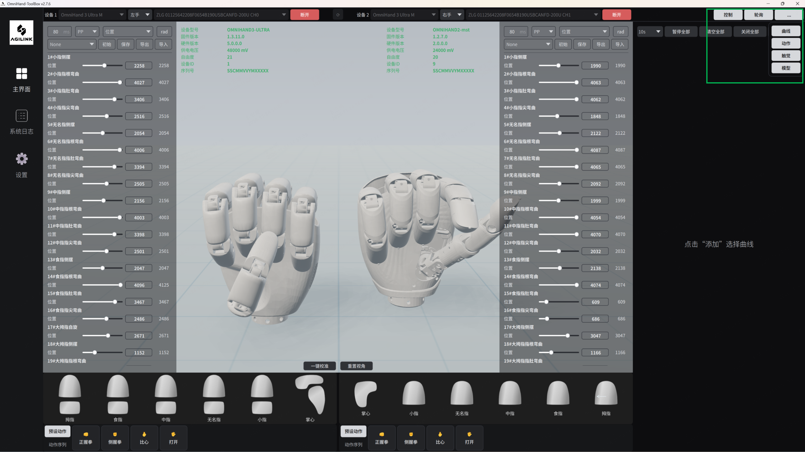

右上角的`控制`、`轮询`和`...`按钮与单手的[显示开关](#显示开关)作用相同。双手模式下，`...`菜单中提供`曲线`、`动作`、`触觉`、`模型`。

#### 添加曲线

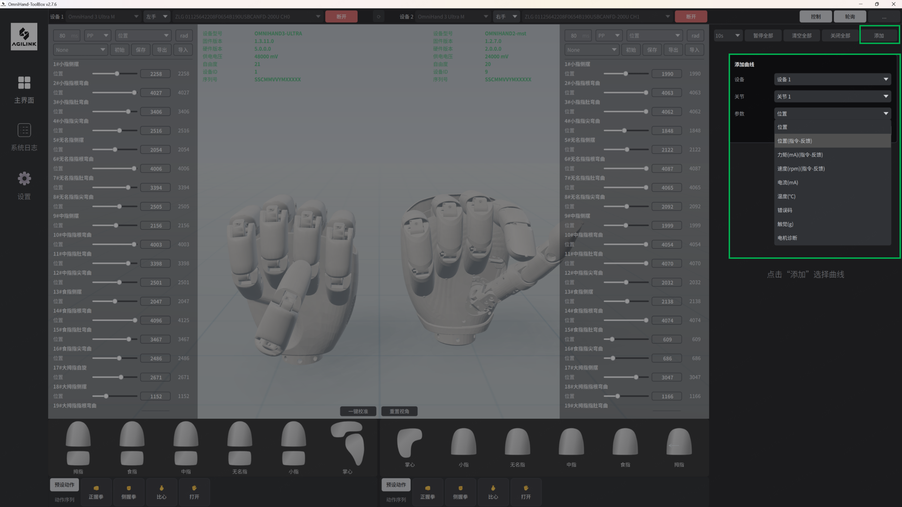

曲线栏为空时显示提示"点击“添加”选择曲线"。点击曲线栏的`添加`，在弹出的"添加曲线"对话框中依次选择：

- **设备**：选择设备1或设备2，即要查看哪只手的曲线。
- **关节**：选择该设备的关节。
- **参数**：可选 位置、位置(指令-反馈)、力矩(mA)(指令-反馈)、速度(rpm)(指令-反馈)、电流(mA)、温度(℃)、错误码、触觉(g)、电机诊断。

选择完成后即可为对应设备新增一条曲线。

#### 预设动作

两只手在界面底部各有独立的预设动作栏，各自点击即可，互不影响。动作内容与单手一致（见[动作配置](#动作配置)）。

#### 实时曲线

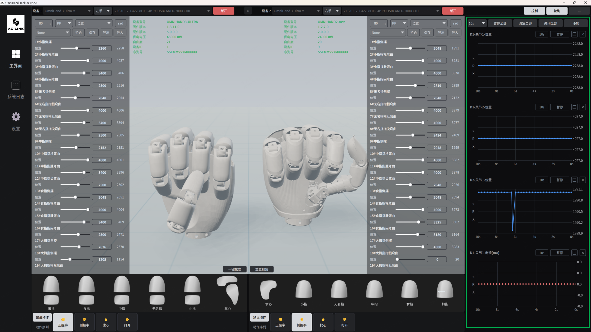

可以同时查看两只手的曲线，曲线名称中的`D1`、`D2`分别表示设备1、设备2，例如`D1-关节1-位置`。

#### 动作序列

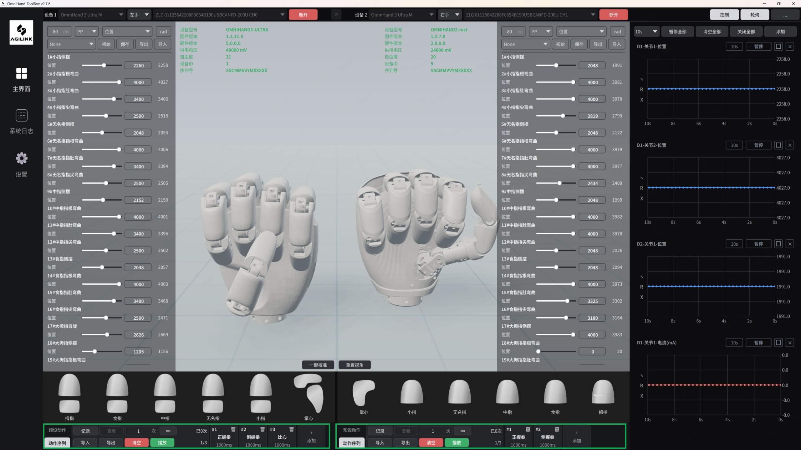

两只手在界面底部各有独立的动作序列栏，分别编辑、播放，使用方法与单手一致（见[动作配置](#动作配置)）。

#### 一键校准与重置视角

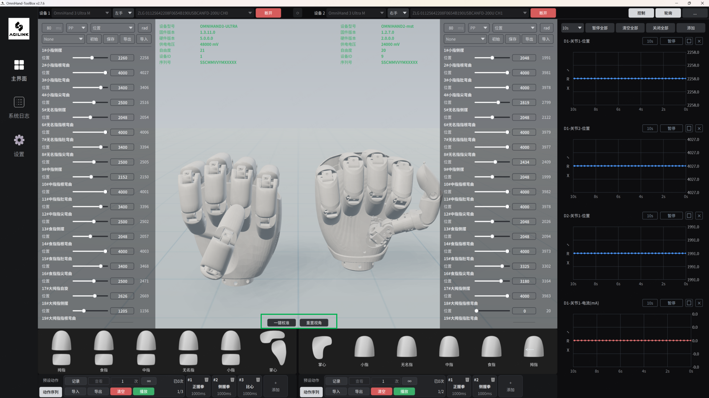

3D 区域底部中间的`一键校准`、`重置视角`，功能与单手一致（见[3D手部模型](#3d手部模型)）。
