# OmniPicker 3 User Guide

[简体中文](omnipicker_3_guide_zh_cn.md)

## Login

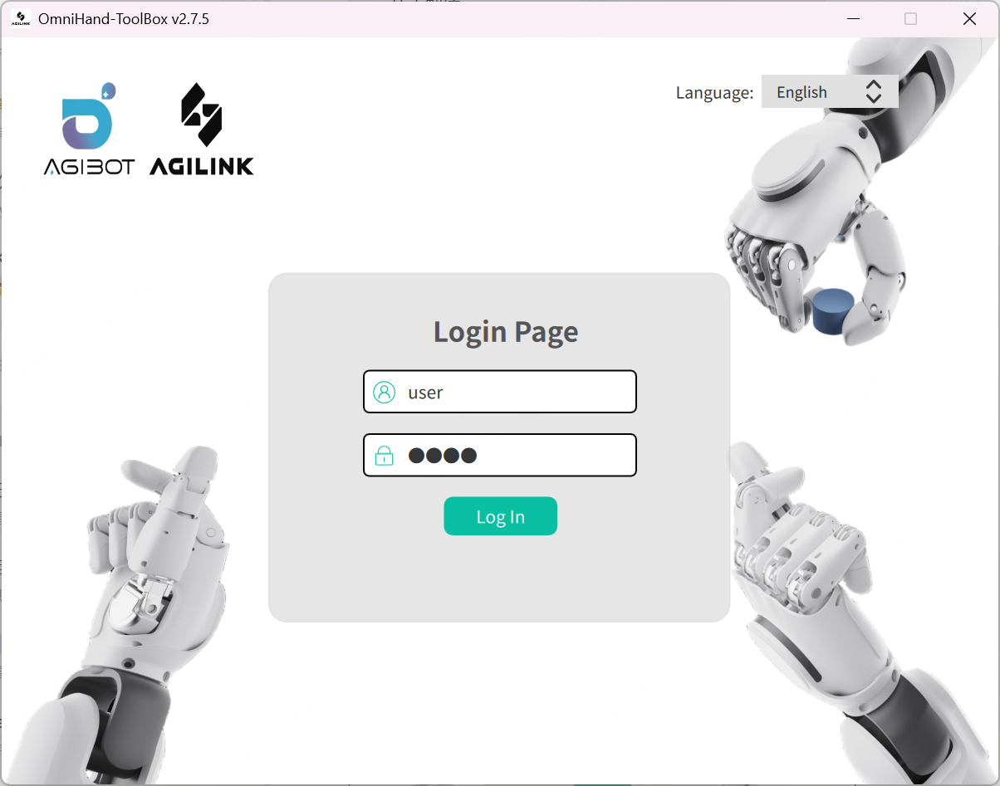

The window title shows the ToolBox version, for example, `OmniHand-ToolBox v2.7.6`.

Use the language selector in the upper-right corner to switch between **简体中文** and **English**.

Click **Login** to enter the User main interface. Both the default username and password are `user`; no changes are required.

## Main Interface

After login, the main interface opens:

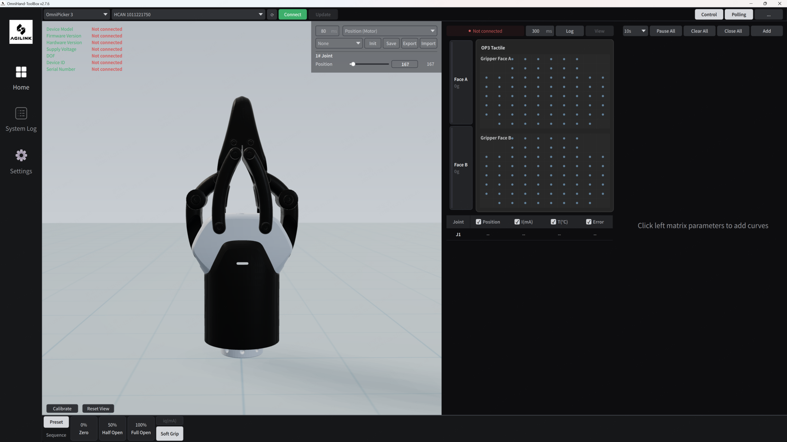

### Main Interface Layout

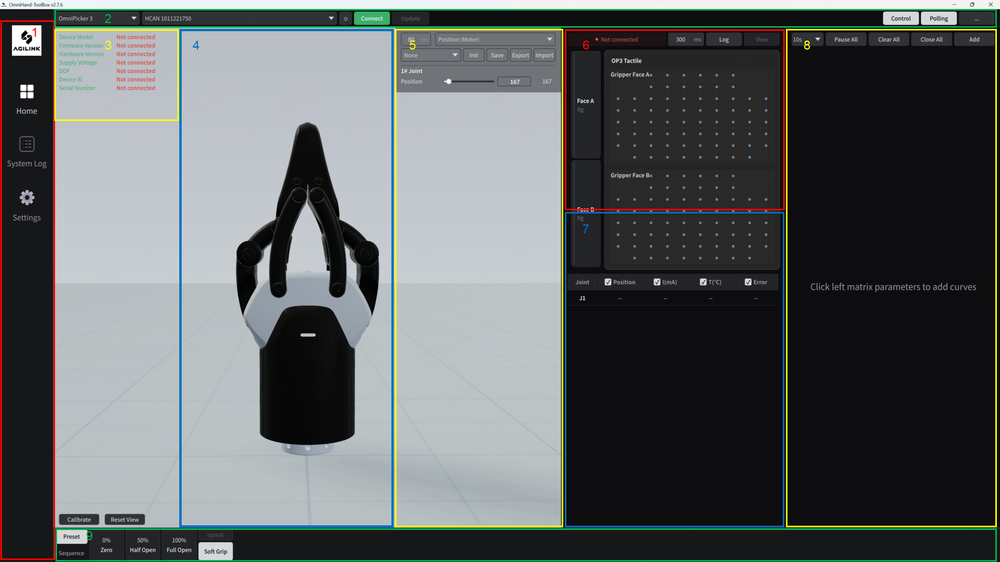

The main interface has nine areas:

1. **Navigation:** Home, [System Log](#system-log), and [Settings](#settings).
2. **Connection and layout:** product and device selection, **Connect / Disconnect**, and **Update**, which becomes available after connecting (see [Quick Connection and Device Status](#quick-connection-and-device-status) and [Firmware Update](#firmware-update)); and the display switches at the upper right (see [Display Switches](#display-switches)).
3. **Device status:** device information (see [Quick Connection and Device Status](#quick-connection-and-device-status)).
4. **Hand model:** a 3D preview that follows joint positions, with **Calibrate** and **Reset View** at the lower left (see [3D Hand Model](#3d-hand-model)).
5. **Control:** control modes, action library import/export, and joint parameter sliders (see [Joint Control](#joint-control)).
6. **Tactile distribution:** live tactile data for Gripper Face A and Gripper Face B; the polling status, interval, and **Log** controls are at the top (see [Tactile Distribution](#tactile-distribution) and [Polling and Joint Status Matrix](#polling-and-joint-status-matrix)).
7. **Joint status:** polling checkboxes and the status matrix (see [Polling and Joint Status Matrix](#polling-and-joint-status-matrix)).
8. **Curves:** live charts and chart controls (see [Real-Time Curves](#real-time-curves)).
9. **Action configuration:** Preset and Sequence tabs (see [Action Configuration](#action-configuration)).

### Display Switches

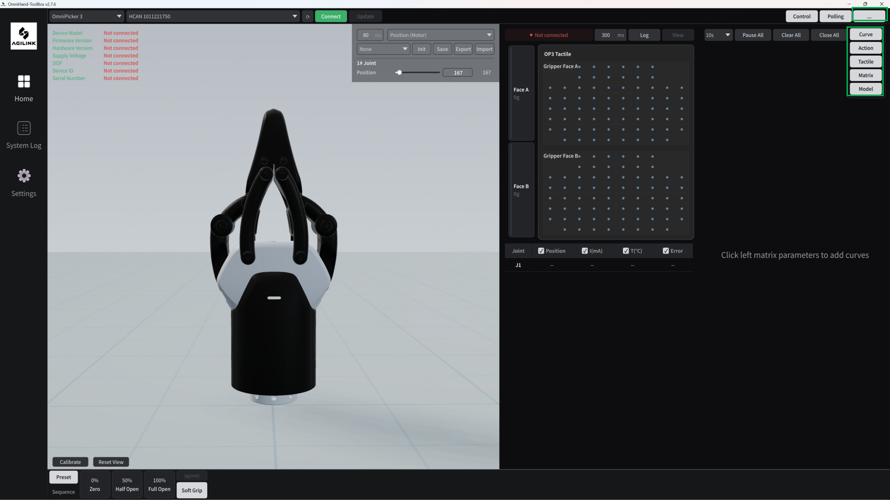

The **Control** and **Polling** buttons and the **...** menu are at the upper right. A highlighted switch means the corresponding area is visible; a dimmed switch means it is hidden.

- **Control:** show or hide area ⑤, the control column.
- **Polling:** turn polling on or off (see [Polling and Joint Status Matrix](#polling-and-joint-status-matrix)).

The **...** menu contains:

- **Curve:** show or hide area ⑧, the curve column.
- **Action:** show or hide area ⑨, action configuration.
- **Tactile:** show or hide area ⑥, tactile distribution. This switch also controls tactile acquisition.
- **Matrix:** expand or collapse the data rows in area ⑦. The position, current, temperature, and error polling checkboxes remain visible in the header.
- **Model:** show or hide area ④, the hand model.

### Quick Connection and Device Status

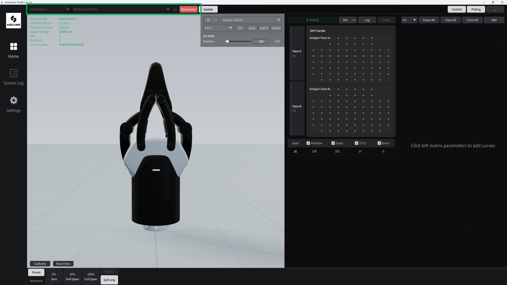

1. Connect the OmniPicker 3 to the computer through ZLG CAN, HCAN, or RS485, then power on the OmniPicker 3. The recommended supply voltage is **24 V**.
2. Select a detected CAN FD adapter from the device dropdown. If it shows **No device found**, click **⟳** on the right to refresh the list.
3. Select the product. It appears as **OmniPicker 3** in the product dropdown.
4. Click **Connect**. After a successful handshake, the device information area displays the actual device details, and the green **Connect** button becomes a red **Disconnect** button. The **Update** button also becomes available.

For detailed connection settings, such as CAN adapter index, channel, serial port, and baud rate, open [Settings](#settings) from the navigation bar.

If the device dropdown still shows **No device found** after refreshing, check the CAN adapter or USB-to-RS485 adapter and its connection to the computer. ZLG CAN, HCAN, and RS485 are supported. SocketCAN is also supported on Ubuntu when the adapter's official SocketCAN driver is installed and the interface is configured for **1 Mbit/s arbitration at an 80% sample point and 5 Mbit/s data at a 75% sample point** (`1M@80% + 5M@75%`).

The following screenshot shows a successful connection:

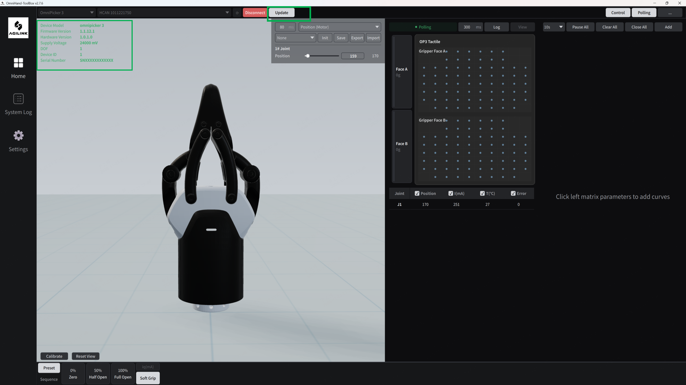

- **Update:** in the top connection bar; opens the [Firmware Update](#firmware-update) page.
- **Device information:** seven items are shown: model, firmware version, hardware version, supply voltage, degrees of freedom, device ID, and serial number.

When disconnected, the device information fields show **Not connected** in red:

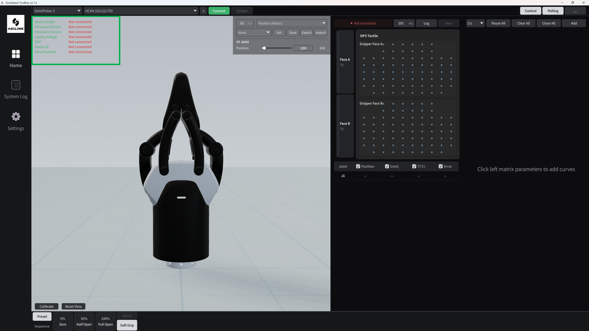

If the CAN adapter is connected but communication with the OmniPicker 3 fails, the fields show **Unavailable** in yellow. Check the OmniPicker 3's power supply, wiring, connectors, and pin assignments:

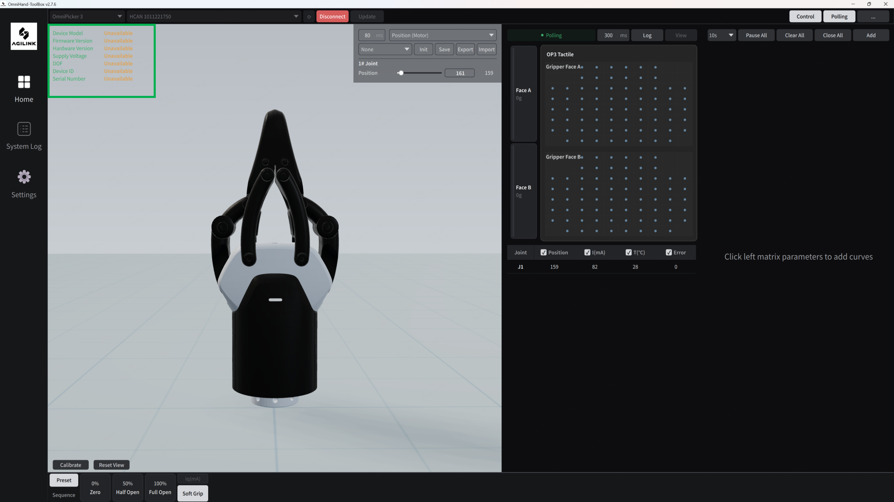

An abnormal CAN adapter connection may indicate that the adapter was unplugged or has a loose connection:

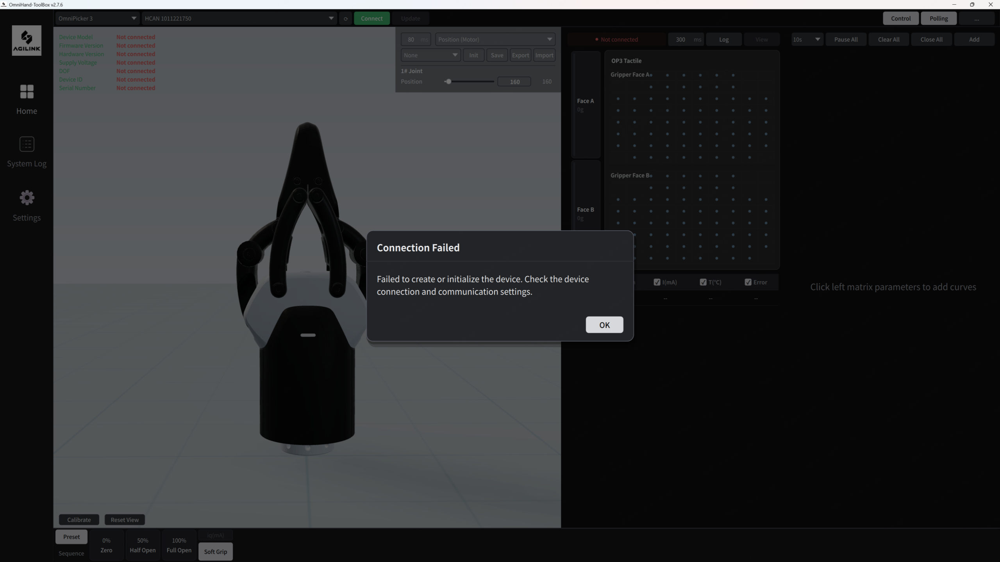

### Polling and Joint Status Matrix

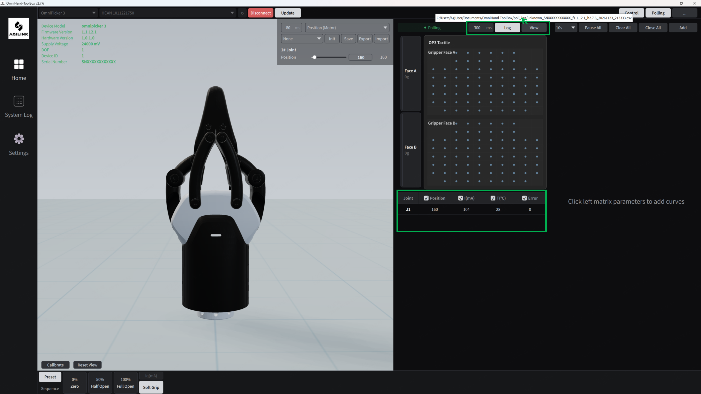

**Polling:** enable periodic queries to the OmniPicker 3 at the configured interval. Disabling it stops periodic queries, and the matrix retains the last values received.

**Interval (ms):** the polling interval, **300 ms** by default. Press **Enter** to apply a change. Shorter intervals increase bus load; the default is generally sufficient.

**Log:** continuously write polled data to a CSV file while enabled.

**View:** hover over this button to see the recording's full CSV path; click it to open the containing folder.

**Joint status matrix:** each row shows a joint's position, current (mA), temperature (℃), and error code. Fields show `--` when disconnected.

The position, current, temperature, and error checkboxes in the matrix header independently select which parameters are polled. The **Tactile** switch in the **...** menu controls both tactile visibility and whether tactile data is queried.

Click a parameter cell in the matrix to add a live chart for that joint and parameter (see [Real-Time Curves](#real-time-curves)).

### Real-Time Curves

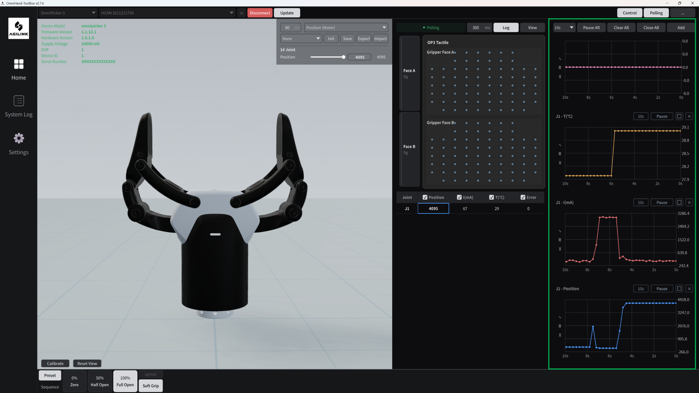

The toolbar at the top of the curve column provides these controls:

- **Time window:** choose the duration shown on the X axis, with options from 1 second to 5 minutes.
- **Pause All / Resume All:** pause or resume updates to all chart views.
- **Clear All:** clear the data in all charts.
- **Close All:** close all chart cards.
- **Add:** open the chart selection dialog, choose a parameter, and add a chart. The available parameters are the four data items of joint 1: position, current, temperature, and error.

If polling is disabled or a parameter's checkbox is cleared, that polled data stops updating and its polling chart freezes.

When no charts are open, a prompt asks you to click a parameter in the matrix. Clicking a matrix cell also adds its chart.

Each chart card provides the following controls:

- **Drag:** the first of the three small controls on the left. It appears only in card mode; drag it to reorder chart cards.
- **Reset (R):** the second control on the left. Reset X/Y zoom and the view to their defaults. Shortcut: **Ctrl + R**.
- **Clear (X):** the third control on the left. Clear the chart's existing data and start plotting again.
- **Time window:** at the upper right of the card. It works like the column's time-window dropdown but affects only this chart. Its tooltip lists zoom and pan shortcuts.
- **Pause / Resume:** pause or resume updates to this chart view.
- **Maximize / Restore:** expand the chart to fill the window or return it to card mode.

Move the pointer over the target chart before using these shortcuts:

| Shortcut | Function |
| --- | --- |
| Ctrl + ↑ / ↓ | Zoom the Y axis in / out |
| Ctrl + → / ← | Zoom the X axis in / out |
| Ctrl + Shift + ↑ / ↓ | Pan vertically |
| Ctrl + Shift + ← / → | Pan horizontally while paused |
| Ctrl + R | Reset the view |

### Joint Control

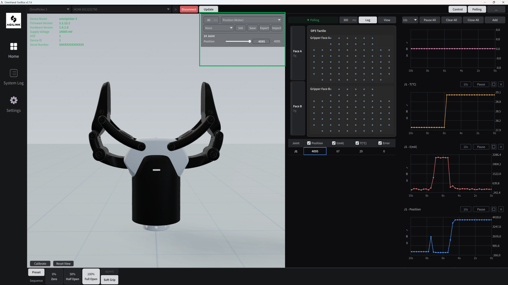

**Debounce:** set the interval in milliseconds at which slider changes are sent, reducing the CAN FD bus load caused by continuous input.

**Control mode:** this product supports four control modes: Position (Motor), Position (Stroke), Position＋Torque, and Distance＋Speed＋Current.

| Mode | Command Parameters | Description |
| --- | --- | --- |
| Position (Motor) | Motor encoder position, 0–4095 | Default mode; set the target position only |
| Position (Stroke) | Stroke (-5 to 112 mm) | Set the target position as a stroke; the lower limit of -5 mm lets the gripper keep outputting force when fully closed |
| Position＋Torque | Position and torque current (0–3500 mA) | Limit the torque current while controlling position; default current: 3000 mA |
| Distance＋Speed＋Current | Stroke (mm), speed (rpm), and current (mA) | Also specify speed and current; default speed: 3000 rpm, default current: 3000 mA |

**Action dropdown:** lists the custom actions available. Selecting an action updates the sliders to its saved positions and immediately sends the action to the OmniPicker 3. The first entry, **None**, means no action is selected. To delete an action, right-click its row or click the **✕** shown on hover.

**Init:** return the joint to the initial position captured when the device connected.

**Save:** save the current slider positions as a custom action; enter a name when prompted. The saved action then appears in the **Action dropdown** list. To export it to a file, use **Export**.

**Export:** export all custom actions in the library to a `.json` file (see [Action Files](#action-files)).

**Import:** read actions from a `.json` file and add them to the library. If names conflict, a confirmation dialog lists the actions that will be overwritten.

**Joint sliders:** each joint has a number and name, followed by parameter sliders, target-value inputs, and current feedback values. Drag a slider to control the joint, or type a target value and press **Enter** to send it.

### 3D Hand Model

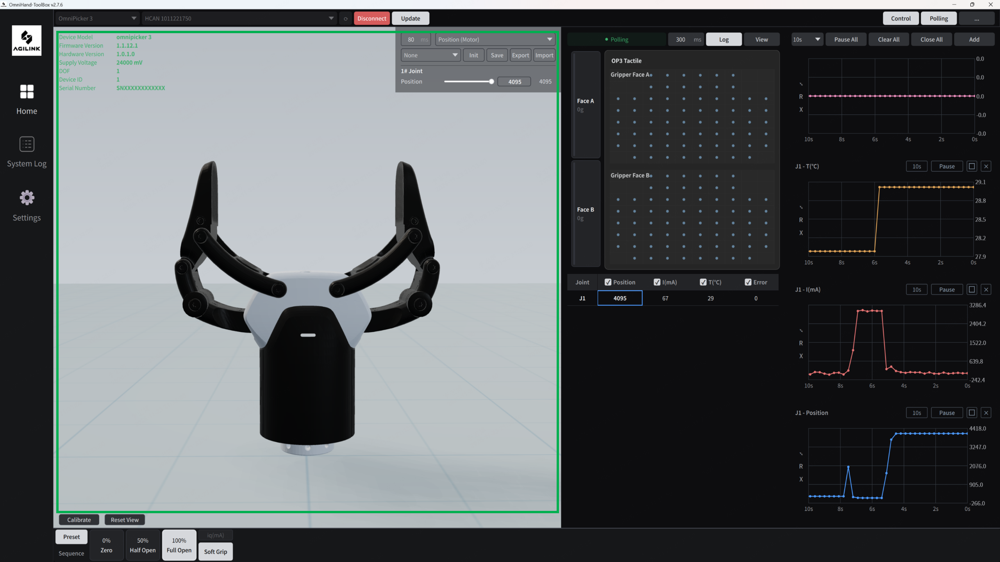

After connection, the model follows the joint's current position. Use the mouse to rotate, zoom, or pan the view. Turn off **Model** in the **...** menu when it is not needed to free space for the curve and tactile areas.

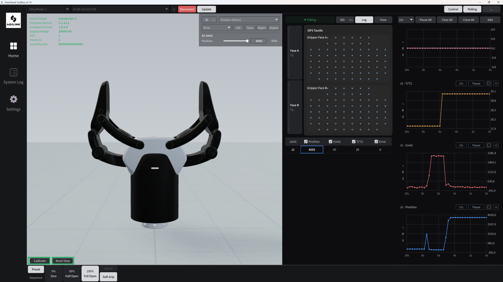

**Calibrate:** restore the OmniPicker 3 and the model to the default pose.

**Reset View:** restore the default camera view.

### Tactile Distribution

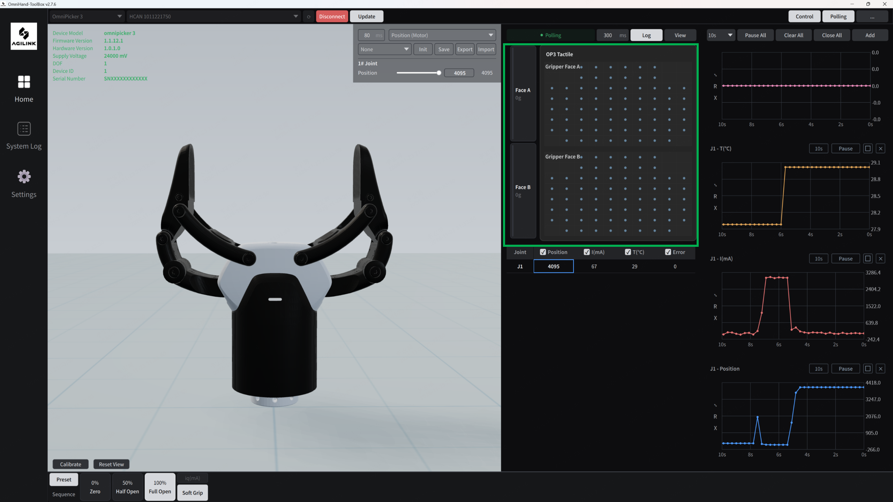

The **Tactile** switch in the **...** menu is enabled and highlighted by default. While enabled, the area titled **OP3 Tactile** displays live data. Turn the switch off to hide the area.

The display is arranged as follows:

- **Regional readings on the left:** show the total force in g for each of two regions: Face A and Face B. The color bar beside each value changes from blue to red as force increases, making the contacting gripper face easy to identify.
- **Dot matrix on the right:** show the measurement points of each region (Gripper Face A and Gripper Face B) as a dot matrix.

### Action Configuration

The action configuration area has two tabs: **Preset** and **Sequence**.

**Preset**

These are the fixed actions built into the SDK, 3 in total: **0% Zero** (zero position), **50% Half Open**, and **100% Full Open**. Click a button to move the OmniPicker 3 to the corresponding position. Built-in actions cannot be edited.

Click **Soft Grip** and the OmniPicker 3 slowly closes inward to grip. Use the **iq(mA)** field to set an additional current limit in mA; it can be left empty.

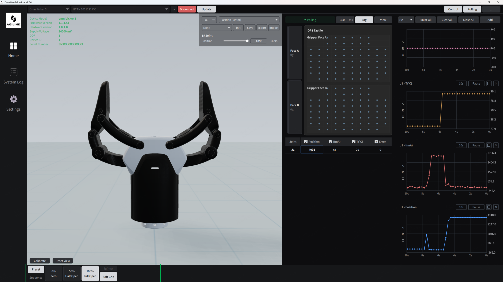

**Sequence**

Combine actions into a sequence for repeated execution:

- **Add:** add an action card. Click the card's name to open its editor, select an action from the dropdown, and enter the interval after that action in milliseconds.
- **Log:** when highlighted, record runtime data to CSV during sequence playback.
- **View:** hover to see the recording's full CSV path; click to open its folder.
- **Times:** enter a repeat count, or select **∞** for continuous playback. The completed repeat count is shown beside it.
- **Import:** load an action sequence from a JSON file (see [Action Files](#action-files)).
- **Export:** save the current action sequence to a local JSON file.
- **Clear:** remove all action cards from the current sequence, avoiding the need to delete a long imported sequence one step at a time.
- **Play / Stop:** execute the steps in order or stop playback. The current step is shown beside the controls.

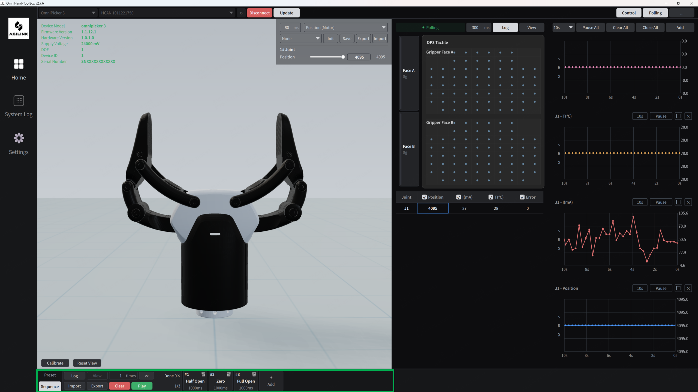

### Action Files

**Action library file (JSON):** imported/exported through the control column; defines individual actions. Action names in these examples are preserved as identifiers, including Chinese names.

```json
{
    "actions": [
        {
            "name": "Full Open",
            "pos_axis_1": 4095,
            "position_type": "encoder"
        },
        {
            "name": "Half Open",
            "pos_axis_1": 2048,
            "position_type": "encoder"
        },
        {
            "name": "Zero Position",
            "pos_axis_1": 0,
            "position_type": "encoder"
        }
    ],
    "format": "omnihand-actions",
    "product_type": "OMNI_PICKER_3",
    "version": 3
}
```

**Action sequence file (JSON):** imported/exported through the Sequence tab. Steps can use preset actions, individual actions from the action library, or actions loaded from a local file.

```json
{
    "format": "omnihand-sequence",
    "product_type": "OMNI_PICKER_3",
    "sequence_name": "默认序列",
    "steps": [
        {
            "delay_ms": 1000,
            "gesture_id": 2,
            "name": "Full Open",
            "source": "preset"
        },
        {
            "delay_ms": 1000,
            "gesture_id": 1,
            "name": "Half Open",
            "source": "preset"
        },
        {
            "delay_ms": 1000,
            "gesture_id": 0,
            "name": "Zero Position",
            "source": "preset"
        },
        {
            "delay_ms": 1000,
            "gesture_id": 1,
            "name": "Half Open",
            "source": "preset"
        }
    ],
    "version": 2
}
```

### Firmware Update

After connecting, click **Update** at the top of the window:

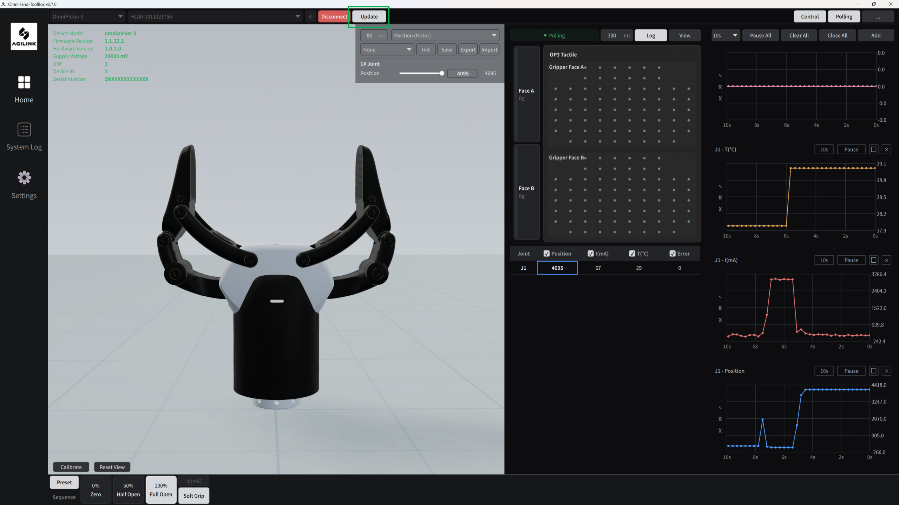

Click **Select** and choose the firmware file from a local folder. The update starts once the file is selected, and the page shows progress through Download, Request, Transfer, Finalize, Restart, and Complete:

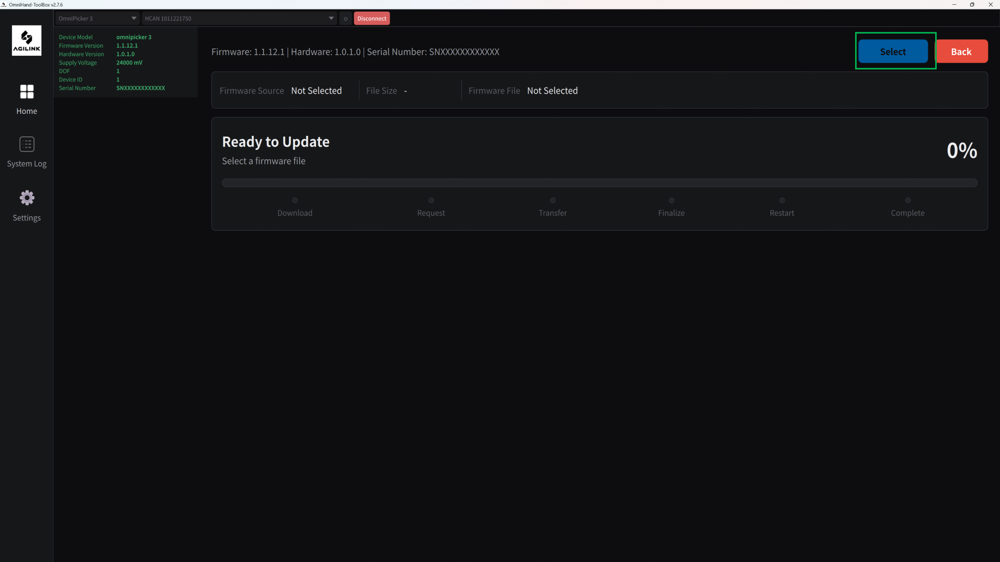

When progress reaches **100%** and the page shows **Update Complete** (the device has restarted and the connection is restored), click **Back** to return to the main interface:

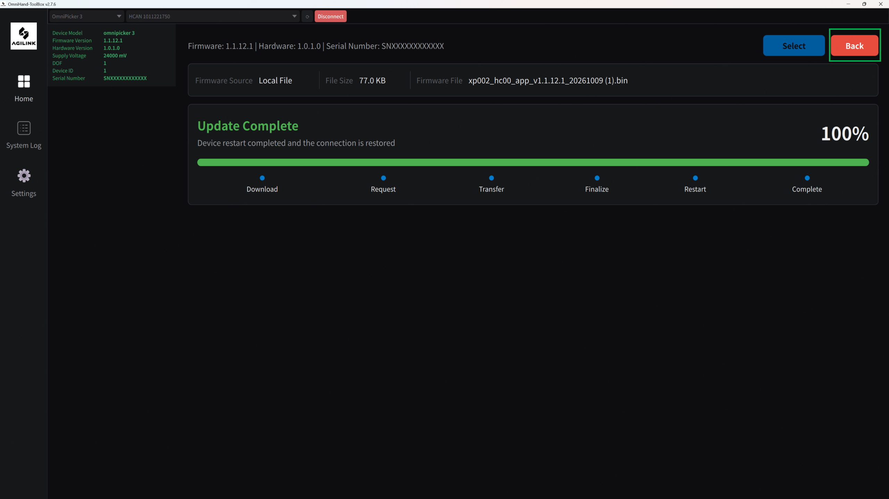

### Matrix and Curves

Click a numeric matrix cell to open its chart, or use **Add** in the curve column to select a parameter. The available chart data are the polled values of joint 1: position, current, temperature, and error. Each card can be paused, cleared, maximized, or closed; the toolbar applies pause, clear, and close to all charts.

Click a legend to show or hide its series, and hover over the plot to inspect values. Pausing a chart freezes its view while acquisition continues; turning off **Polling** stops periodic acquisition.

### System Log

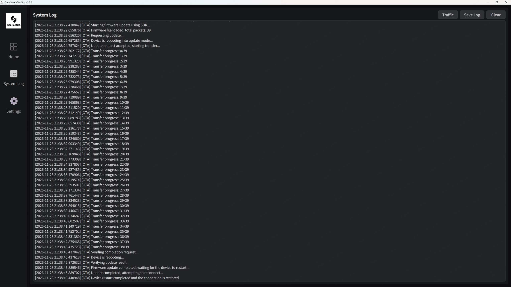

- **Traffic:** enable this switch to display transmitted and received messages.
- **Save Log:** export the log.
- **Clear:** clear the displayed log in the screen.

### Settings

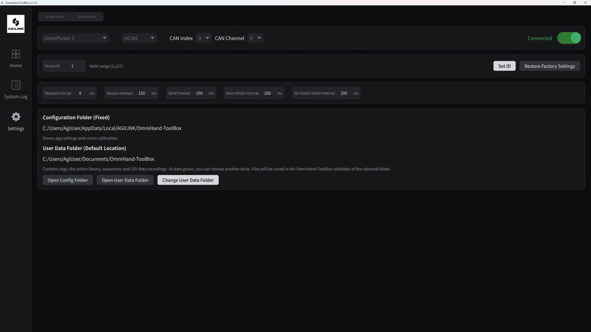

The settings page provides the full connection configuration:

- **Product:** select **OmniPicker 3**, the model name of this product in the software.
- **Connection type:** ZLGCAN, HCAN (both CAN FD), or RS485. SocketCAN is also available on Linux. The parameter area changes with the selected connection type.
- **Connection parameters:** for CAN FD, set the adapter index and channel to match the USB-to-CAN FD adapter (defaults: `0 / 0`). For RS485, set the serial port and baud rate.
- **Connection switch:** connect or disconnect using the switch on the right. The adjacent status text indicates disconnected, connecting, connection failed, or connected.
- **CAN FD bus parameters:** the application applies the fixed values required by the communication protocol; no manual configuration is needed.

Once connected, the product, connection type, and connection parameters are disabled. Disconnect before changing them.

You can also set the device ID to a value from **0x01 to 0x7F**, or restore the factory-default device ID.

Timing settings include:

- **Request interval:** the gap between successive requests (default 4 ms).
- **Receive timeout:** the maximum wait for a reply frame; the operation returns as soon as the reply is received (default 150 ms).
- **Send timeout:** the maximum time the underlying send or write operation may wait (default 100 ms).
- **Data refresh interval:** control how often the UI displays updated data (default 200 ms).
- **3D model refresh interval:** control how often the 3D model is updated (default 200 ms).

You can also open the configuration folder and the user data folder; **Change User Data Folder** moves where data is saved.
